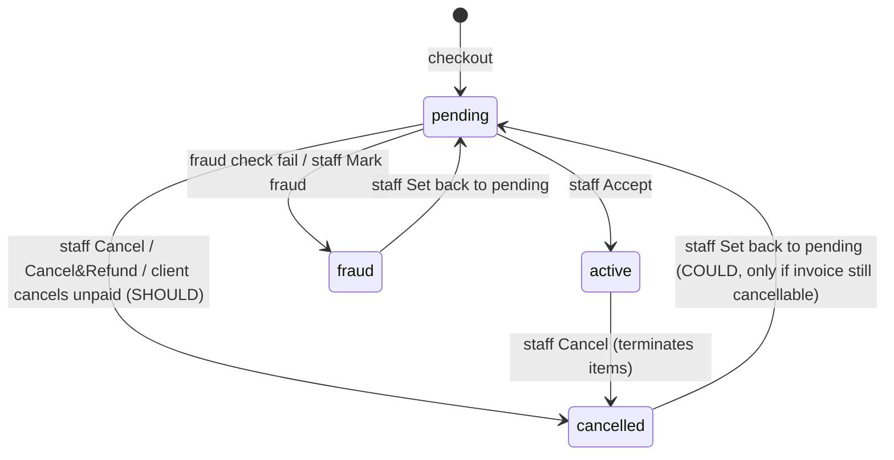

# Orders — Product Spec (v1)

Status: draft for engineering · Owner: Orders workstream · Refines FEATURE_MAP §2
Clean-room: behaviour derived from public category docs (WHMCS, Blesta, FOSSBilling); naming/schemas are ours.

## 1. Purpose & scope

Orders turns a shopping cart into durable records: an **order** (immutable commercial snapshot), pending
**services/addons/domains** (via `ServiceRegistry` / `DomainRegistry`) and the first **invoice** (via `Invoicer`).
It owns the cart, checkout, promotions/coupons, fraud screening and the staff acceptance workflow.
Renewals do **not** create orders (Services/Billing handle them). Upgrades create an order of `kind=upgrade` (see services.md §5).

## 2. Entities & key fields

### carts

`id, token (uuid, cookie/API header), client_id (nullable), currency, promotion_code (nullable), items (json snapshot, versioned schema), expires_at, timestamps`

- Guest carts keyed by token, merged into the client's cart on login (guest items win on conflict). **MUST**
- Cart expiry `orders.cart_ttl_days: 7`; prices are **re-quoted on every read** — the cart never trusts stored prices. **MUST**

Cart item kinds (json):

- `product`: `product_id, cycle, quantity, config_options {option_id: value_id|qty}, custom_fields {field_id: value}, domain {mode: register|transfer|existing|subdomain, name}, server_fields {hostname, root_password, ns1_prefix, ns2_prefix}, addons [addon_id…]`
- `addon_for_service`: `addon_id, service_id, cycle` (existing service owned by the client)
- `domain_register` / `domain_transfer` (`name, years, epp_code (transfer, encrypted), dns_management, id_protection, email_forwarding, nameservers[]`)
- `domain_renew`: `domain_id, years`

### orders

`id, number (unique random 10-digit string), client_id, kind (new|upgrade|addon|renewal_manual), status (pending|active|cancelled|fraud),
currency, subtotal, discount_total, setup_total, tax_total, total (all int minor), promotion_id, promotion_code (snapshot), payment_gateway,
invoice_id, ip_address, user_agent, placed_by_user_id, placed_by_staff_id (nullable), notes (client notes), admin_notes,
fraud_provider, fraud_score (decimal 5,2), fraud_decision (pass|review|fail|error|skipped), fraud_payload (json, redacted), accepted_at, cancelled_at, idempotency_key (unique), timestamps`

- Order is a **static snapshot**; later product/price edits never change it. **MUST**

### order_items

`id, order_id, item_type (service|addon|domain|upgrade), item_id (service/addon/domain/service_change id), description, cycle, quantity, first_amount, recurring_amount, setup_fee, discount_amount`

### promotions

`id, code (unique, case-insensitive), type (percent|fixed|price_override|free_setup), value (decimal 10,2 — % or amount in default currency),
recurring (bool), recur_count (int; 0 = unlimited when recurring), applies_to (json: product_ids, addon_ids, tlds), requires (json: product_ids, cycles, tlds),
requires_existing_ok (bool: required item may already be owned), cycles (json|null = any), starts_on (date|null), expires_on (date|null, inclusive),
max_uses (0 = unlimited), uses (int), apply_once (bool), once_per_client (bool), new_clients_only (bool), existing_clients_only (bool),
lifetime (bool: survives upgrades/downgrades), allow_upgrades (bool), upgrade_scope (product|config_options), min_cart_amount (int|null, default currency),
discount_setup_fee (bool, default false), admin_notes, expired_at (nullable manual expiry), timestamps`

### promotion_redemptions

`id, promotion_id, client_id, order_id, item_type, item_id, created_at, released_at (nullable)`

### fraud_checks

`id, order_id, provider, score, decision, reasons (json), raw (json, PII-redacted), duration_ms, created_at`

## 3. Order status machine

- **Order status is a review flag, not a provisioning gate.** Items may be provisioned (auto-setup `on_order`/`on_payment`) while the order is still `pending`; the order stays pending until staff accept. **MUST**
- `orders.auto_accept_on_payment: false` — when true, an order whose invoice is paid and fraud decision is `pass` moves to `active` automatically. **SHOULD**
- Custom sub-statuses (e.g., "building") are **COULD**.

## 4. Checkout flow (MUST)

1. **Validate cart**: each item re-quoted via `PriceBook`; product orderable (not retired, stock > 0, price exists in cart currency); required custom fields/regex; config option min/max; domain availability (Domains); `requires_domain` satisfied; TOS accepted if `orders.require_tos: true`; captcha if enabled for guests.
2. **Identify client**: logged-in user picks client account (Core); or inline registration (creates user + client in the same transaction).
   Cart currency must equal the client's currency; on mismatch the cart is re-quoted in the client currency and the user re-confirms. **MUST**
3. **Choose gateway**: intersection of `product_groups.allowed_gateways` across items ∩ active gateways visible on order form. Empty ⇒ checkout blocked with explanatory error.
4. **Compute totals** (see §5) and show _due today_ vs _recurring_.
5. **Persist atomically** (single DB transaction, guarded by `idempotency_key` from the client — a double submit returns the first order):
   order + items → `ServiceRegistry::createPending` / `createPendingAddon` / `DomainRegistry::createPending` → stock reservation → promotion redemption → `Invoicer::issue` (status `unpaid`, due date = today + `orders.initial_invoice_grace_days: 0`, lines with period_start/end, `applyCredit` if client opted in).
6. **After commit**: run fraud screening (§7). Then emit `OrderPlaced`. Then provisioning for `on_order` items (only if fraud decision ∈ pass|skipped).
7. **Zero total**: invoice is created and immediately marked paid (no transaction row) so the standard `InvoicePaid` path runs. **MUST**
8. **Redirect** per `orders.checkout_redirect: invoice` (`complete_page|invoice|gateway`). Third-party gateways may require `gateway`.
9. Order confirmation email unless `orders.suppress_invoice_email_on_order: false` is true (invoice still created).

## 5. Totals & promotions — rules (MUST unless tagged)

- Per item: `base_first = quote.recurring`, or the prorata first amount when the product uses prorata (catalog.md §3.4; an addon with `prorata_with_parent` follows its parent), `setup = quote.setup`. The invoice line's period is the first period, `[today, first_period_end)`.
- Promotion eligibility (all must hold): code exists and not manually expired; `today ∈ [starts_on, expires_on]` evaluated in **company timezone**, expiry inclusive to 23:59:59; `max_uses = 0 or uses < max_uses`; client constraints (`new_clients_only` = client has no prior non-cancelled orders; `existing_clients_only` = ≥1 active service; `once_per_client` = no unreleased redemption by this client); `requires` items present in cart (or owned, if `requires_existing_ok`); cart subtotal ≥ `min_cart_amount` (converted to cart currency).
- Applicable items: item matches `applies_to` and its cycle ∈ `cycles` (if set). `apply_once` ⇒ only the single most expensive applicable item gets the discount.
- Discount per applicable item:
    - `percent`: `round(base × value/100)`; setup also discounted only if `discount_setup_fee`.
    - `fixed`: `min(base, convert(value → cart currency))`; never negative.
    - `price_override`: `discount = max(0, base − convert(value))` (price becomes value).
    - `free_setup`: `discount = setup`.
- Recurring promos: service stores `promotion_id` and `promotion_cycles_remaining = recur_count` (null = unlimited). Renewal invoices show a gross line + a negative promotion line (billing.md). After the count is exhausted, renewals revert to `recurring_amount` without the promo. Service `recurring_amount` is stored **net** of client-group discount but **gross** of promotion; the promo line is computed at renewal time. **MUST**
- Tax is computed by `TaxCalculator::calculateForClient` on the post-discount amounts (discount reduces the taxable base of the line it discounts).
- Rounding: every per-line amount rounded to minor unit half-up before summation.
- `uses` incremented at checkout; redemption **released** (uses −1) when the order is cancelled or set to fraud before any payment. **SHOULD**
- Promotions on upgrades: allowed only if `allow_upgrades`; discount applies to the prorated upgrade amount; `lifetime` promos are carried to the new product on upgrade. **SHOULD**
- Promo links: `?promo=CODE` stores code on the cart. **SHOULD**

## 6. Domain items in the cart (contract with Domains)

- Product with `requires_domain` must have one of: register (in cart), transfer (in cart), existing (client-owned/external — free text validated as FQDN), subdomain (from product-offered parent domains). **MUST**
- Block ordering a new hosting service with a domain already attached to a pending/active/suspended service: `orders.block_duplicate_domains: true`. **MUST**
- Domain lines priced by `DomainPricing::price(tld, action, years, currency)`; free-domain eligibility from Catalog (catalog.md §3.10). **MUST**
- Transfer requires EPP code when the TLD demands it (stored encrypted). **MUST**
- Domain addons (DNS management, ID protection, email forwarding) priced per year. **SHOULD**

## 7. Fraud screening

- `FraudChecker` contract: `check(OrderContext): FraudResult{decision, score, reasons[], raw}`; providers are drivers. v1 ships `none` and `rules`.
- `rules` driver (configurable): max pending orders per client (`orders.fraud.max_pending_orders: 3`), max orders per IP per 24h (`5`), banned email domains (Core list), disposable email list (COULD), IP country ≠ billing country (COULD, needs GeoIP).
- `orders.fraud.skip_for_existing_clients: true` (client with ≥1 active service ⇒ `skipped`).
- Timeouts/errors: `orders.fraud.fail_open: true` ⇒ decision `error` treated as `review` (order stays pending, no auto-provision). **MUST**
- On `fail`: order → `fraud`, items → `fraud`, invoice remains `unpaid` but **payments are refused** while the order is `fraud` (gateway/checkout shows "order under review"). No credit note is issued unless staff later cancels. **MUST**
- Staff `Set back to pending` re-enables payment; staff `Mark fraud` manually also cancels the invoice. **MUST**

## 8. Admin capabilities

- Orders list with filters (status, client, date, gateway, fraud decision, payment status of invoice), bulk accept/cancel/delete. **MUST**
- Order detail: items with per-item provisioning controls (server pick, username/password override, "run create" checkbox, "send welcome email"), domain registrar pick & "register now", fraud report, notes. **MUST**
- Actions:
    - **Accept**: order → active; for each pending item with selected "run create" (default from auto-setup policy) call `ServiceRegistry::provision` / `DomainRegistry::process`. Failures do not roll back acceptance; they surface in the module queue. **MUST**
    - **Cancel**: order → cancelled; pending items → cancelled (`cancelPending`), active items → terminate via Services; unpaid invoice → cancelled; stock & promo released. **MUST**
    - **Cancel & refund**: as Cancel, plus refund all invoice transactions via gateway where supported (else record-only refund flagged for manual action). **SHOULD**
    - **Mark fraud**: order/items → fraud, terminate any active items, cancel invoice. **MUST**
    - **Set back to pending**: order and fraud items → pending. **MUST**
    - **Delete**: only allowed when the invoice has **no transactions and no applied credit**; deletes order, pending items and draft/unpaid invoice. Otherwise refuse ("cancel instead"). **MUST**
- Staff "place order on behalf of client" using the same pipeline with price override per line, custom promo, option to skip invoice email / skip fraud / mark invoice paid. **MUST** (override & skip) / **SHOULD** (custom promo)
- Promotions CRUD, duplicate, "expire now", usage report (redemptions). Delete only if never redeemed. **MUST**

## 9. Client-area capabilities

- Cart: add/update/remove items, apply/remove promo, see totals in their currency, checkout with registration or login. **MUST**
- Order history with status and link to invoice. **MUST**
- Notes on checkout `orders.allow_checkout_notes: true`. **SHOULD**

## 10. Automation (scheduled)

- `orders:prune-carts` daily — delete expired carts. Idempotent. **MUST**
- `orders:cancel-stale-pending` daily — orders `pending` with unpaid invoice older than `orders.auto_cancel_unpaid_days: 0` (0 = off) → Cancel action. **SHOULD**
- Fraud checks are synchronous at checkout (with a timeout `orders.fraud.timeout_ms: 5000`), re-runnable by staff. **MUST**

## 11. Events emitted

`CartItemAdded`, `PromotionApplied`, `OrderPlaced` (order_id, after commit), `FraudCheckCompleted` (decision), `OrderFlaggedFraud`,
`OrderAccepted`, `OrderCancelled` (refunded: bool), `OrderSetPending`, `OrderDeleted`, `OrderPaid` (first time the order invoice is paid —
listener on `InvoicePaid`). Notifications maps `OrderPlaced` → client confirmation + staff "new order" mail.

## 12. Edge cases & pitfalls

- **Double submit / back-button replays** create duplicate orders → idempotency key + unique constraint.
- **Stale prices in cart** (admin edits price while cart open) → always re-quote; show a "prices updated" notice.
- **Currency switch mid-cart** after login → re-quote, never mix currencies on one invoice.
- Promo **expiry timezone** off-by-one (UTC vs company tz) — evaluate in company tz, inclusive end date.
- Fixed-amount promos defined in default currency must be converted at **current** rate; rounding to minor units.
- Promo `max_uses` race at high concurrency → increment with `WHERE uses < max_uses` check in the transaction.
- Deleting a promotion that services reference silently changes future renewals → forbid delete once redeemed; expire instead.
- Fraud-flagged orders whose invoice is still payable lead to paying fraudsters → block payment while `fraud`.
- Provisioning on payment while order pending surprises staff → order list shows per-item status badges.
- Cancelling an order after partial provisioning must terminate remote accounts, not only flip DB status.
- Mixed product groups with no shared gateway → blocked at step 3 with a clear message.
- Add-funds abuse to bypass fraud checks → Billing requires an accepted order before add funds (billing.md).

## 13. Acceptance criteria

1. Given a guest cart with a product, when the guest logs in with a cart of their own, then the carts merge and the guest item is present.
2. Given a cart quoted at 10.00 and the product price changed to 12.00, when the cart is read, then the total shows 12.00.
3. Given a valid checkout, then one order, its pending service(s), and one unpaid invoice with matching total are created in one transaction.
4. Given the same idempotency key submitted twice, then only one order exists and the second response returns the first order number.
5. Given an order number generator, then numbers are 10 digits and unique (retry on collision).
6. Given a zero-total cart, when checked out, then the invoice is paid and `InvoicePaid` fires.
7. Given a product with auto_setup `on_order` and fraud decision `pass`, then provisioning is dispatched after checkout.
8. Given auto_setup `on_order` and fraud decision `review`, then no provisioning is dispatched.
9. Given fraud decision `fail`, then order and items are `fraud` and a payment attempt on the invoice is rejected.
10. Given a fraud order set back to pending, then payment on the invoice is accepted.
11. Given a percent promo 25% on product P, when P (10.00 monthly, setup 5.00) is in cart, then discount = 2.50 and setup stays 5.00.
12. Given a fixed promo 15.00 on a 10.00 item, then discount = 10.00 (never negative).
13. Given a price_override promo 7.00 on a 10.00 item, then the line is 7.00.
14. Given a free_setup promo, then setup fee discount equals setup.
15. Given a promo expiring 2026-11-30 in company tz Europe/Berlin, when applied at 2026-11-30 23:30 local, then it is valid; at 2026-12-01 00:01 local it is invalid.
16. Given max_uses=1 and uses=1, then applying the code fails with "usage limit reached".
17. Given new_clients_only and a client with a prior active order, then the code is rejected.
18. Given once_per_client and an existing redemption for the client, then the code is rejected.
19. Given apply_once and two applicable items, then only the more expensive item is discounted.
20. Given `requires` product A and a cart with only B, then the code is rejected; with A and B it applies to B.
21. Given a recurring promo with recur_count=2, then the service stores 2 remaining promo cycles.
22. Given a cancelled unpaid order with a promo, then the redemption is released and `uses` decremented.
23. Given a product with requires_domain and no domain selection, then checkout fails validation.
24. Given `block_duplicate_domains` and a domain already on an active service, then the item is rejected.
25. Given two items from groups with no common gateway, then checkout is blocked with an explanatory error.
26. Given staff Accept with "run create", then `ServiceRegistry::provision` is called for each pending service and the order becomes active even if one provision fails.
27. Given staff Cancel on an order with an active service, then the service is terminated, the unpaid invoice cancelled and stock restored for never-activated items.
28. Given an order whose invoice has a transaction, when staff Delete, then the action is refused.
29. Given stock 0 on a product in a cart, when checking out, then validation fails with "out of stock".

## 14. Out of scope for v1

Third-party fraud providers (MaxMind/FraudLabs-style) beyond the driver contract; identity verification; custom order statuses;
product bundles; cross-sell recommendations; abandoned-cart emails; multiple order form templates; quote→order conversion with provisioning
(quotes convert to invoices only, see billing.md); gift cards; buy-X-get-Y beyond `requires`; affiliate attribution UI (Affiliates module captures referral id on the order).
