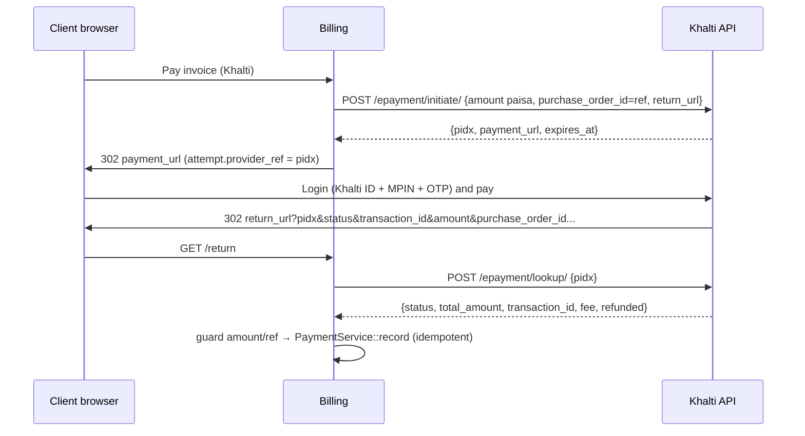
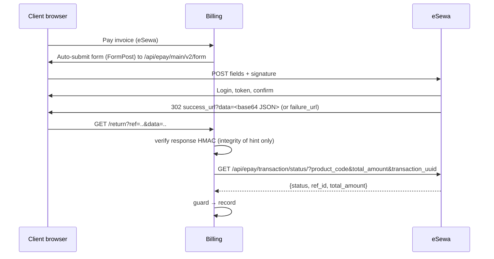
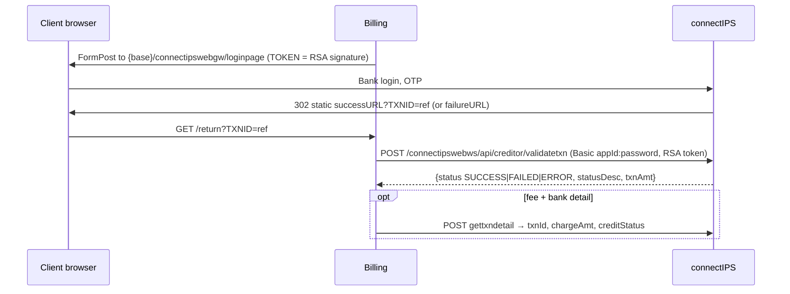

# Payments — Nepal gateway drivers (design, v1)

Status: research + design, no code · Owner: Billing (payments) · Refines `billing.md` §6 · Docs read 2026-10-17
Clean-room: written from the providers' public developer docs (see §7) in our own words. All keys, ids and
signatures below are **fake** unless marked "UAT (public)". Nothing here was copied from SDKs.

## 0. Key facts that shape the design

- **Nothing pushes to us.** None of the v1 providers publishes a server-to-server webhook for web checkout. The
  only inbound signal is the customer's browser coming back to a return URL. So each driver needs an
  authoritative **server-side lookup**, plus a **reconciliation poller** for customers who never come back.
  `billing.md` §7 lists the poller as COULD; for Nepal it is a **MUST**.
- **NPR only.** Every provider settles in NPR. A USD or INR invoice may only use these gateways through the
  gateway's `convert_to_currency = NPR` (§4.9), and the stored rate is used.
- **Amount units differ.** Khalti and ConnectIPS take integer **paisa** (that's our minor unit, so no conversion).
  eSewa, Fonepay and IME Pay take **rupee decimal strings**, and eSewa can send back `"1,130.0"`.
- **Refunds are mostly manual.** Only Khalti has a refund API. Everything else uses the merchant portal or the bank.
- **Merger:** Khalti's docs footer now reads "IME Khalti Limited", so IME Pay and Khalti have one owner. Khalti
  covers IME Pay's users for v1.

## 1. Provider comparison

|                   | Khalti (KPG-2)                              | eSewa (ePay v2)                       | ConnectIPS (NCHL)                                                   | Fonepay (web/QR)                                      | IME Pay                             |
| ----------------- | ------------------------------------------- | ------------------------------------- | ------------------------------------------------------------------- | ----------------------------------------------------- | ----------------------------------- |
| Model             | Server initiate → redirect to `payment_url` | Browser form POST → redirect back     | Browser form POST → redirect back                                   | GET redirect, or dynamic QR + poll                    | Server token → redirect             |
| Request auth      | `Authorization: Key <secret>`               | HMAC-SHA256, base64                   | RSA SHA256withRSA (merchant `.pfx`), base64                         | HMAC-SHA512, hex                                      | Basic auth + `Module` header        |
| Return signed?    | No (plain query)                            | Yes (base64 JSON with HMAC)           | No (only `TXNID`)                                                   | Yes (`DV`, HMAC-SHA512)                               | No (base64 pipe string)             |
| Verification API  | `POST /epayment/lookup/`                    | `GET /api/epay/transaction/status/`   | `POST /connectipswebws/api/creditor/validatetxn` (+ `gettxndetail`) | `GET /api/merchantRequest/verificationMerchant` (XML) | `POST /api/Web/Confirm`, `/Recheck` |
| Refund            | **API**, full or partial                    | Manual (portal); status shows refunds | Manual (via bank)                                                   | Manual                                                | Manual                              |
| Sandbox           | Self-serve (`dev.khalti.com`)               | Public UAT keys                       | On request (NCHL support)                                           | From the acquiring bank                               | On request                          |
| Amount unit       | paisa int (min 1000)                        | rupees string                         | paisa int                                                           | rupees string                                         | rupees                              |
| Expiry            | `expires_at` from API (60 min prod default) | 15 min after login                    | Session based                                                       | Bank-defined                                          | Token based                         |
| Fees / settlement | Not public; Khalti wallet then bank         | Not public; withdraw to bank free     | Charge per txn (`chargeAmt`, `chargeLiability`)                     | Bank contract                                         | Not public                          |
| Public docs       | Yes                                         | Yes                                   | Yes                                                                 | **No** (bank-supplied spec)                           | **No**                              |
| v1 priority       | **P1**                                      | **P1**                                | **P2**                                                              | P3                                                    | P4 (Khalti covers it)               |

Not in v1: **NPS OnePG** and **Hamro Pay** (aggregators; NPS also takes cards. Both have gated docs, so they're v2
candidates). **Bank card acquiring** (Nabil, NIC Asia and others run CyberSource/Mastercard-style hosted pages,
each under its own bank contract) is per-merchant, so we leave it for later. **PayPal** cannot pay out to Nepali
merchants and NRB limits foreign payment schemes, so don't offer it to NP entities.

## 2. Per-provider integration specs

Our side of every flow is the same. `initiate` creates a `payment_attempt` (§3.2) with a short unique
`reference` (format `inv-<invoice>-a<n>`; `[a-z0-9-]` only and at most 20 characters to fit ConnectIPS `TXNID`,
eSewa `transaction_uuid` and Fonepay `PRN` 3–25). The return URL is
`GET /billing/gateways/{key}/return?ref=<reference>`. It is **never authoritative**: it always ends in `lookup()`.

### 2.1 Khalti — KPG-2 Web Checkout (P1)



- Base URL is `https://dev.khalti.com/api/v2/` in sandbox and `https://khalti.com/api/v2/` in production.
  Requests send the header `Authorization: Key <live_secret_key>`. The sandbox uses the "live" secret key from
  `test-admin.khalti.com`. A missing `Key ` prefix returns 401.
- **Initiate request:** `return_url`, `website_url`, `amount` (integer paisa, at least 1000), `purchase_order_id` (our
  ref), `purchase_order_name`, and optionally `customer_info{name,email,phone}`, `amount_breakdown[]` (must sum to
  amount), `product_details[]`, and `merchant_*` extras (echoed back). Validation errors come back as
  `{field: [msg], error_key: "validation_error"}`.
- **Return query:** `pidx, status (Completed|Pending|User canceled), transaction_id, tidx, txnId, amount,
total_amount, mobile, purchase_order_id, purchase_order_name`. None of it is signed, so treat it all as hints.
- **Lookup response:** `{pidx, total_amount, status, transaction_id, fee, refunded}`. **Pitfall:** `Expired` and
  `User canceled` come back as **HTTP 400** with a normal body. Parse the body before treating it as a transport
  error.
- **Status mapping:** `Completed` → succeeded. `Pending` → pending; hold the service, raise a staff todo, keep
  polling. `Initiated` → pending until `expires_at`. `Expired` → expired. `User canceled` → cancelled (failed).
  `Refunded` / `Partially Refunded` → refunded; if the attempt was already paid, alert staff (§3.5). Khalti says
  only `Completed` counts as paid.
- **Refund:** `POST https://{dev.}khalti.com/api/merchant-transaction/{transaction_id}/refund/` with the same header.
  An empty body refunds in full; `{amount}` refunds part. Bank-funded payments also need `mobile` (store the payer
  `mobile` from the return in `raw`). The docs say "paisa" but the examples show `50.00`. Send integer paisa and
  confirm in sandbox. Success is `{"detail": "Transaction refund successful."}`.
- **Test data:** Khalti IDs 9800000000–9800000005, MPIN 1111, OTP 987654. The sandbox is wallet-only (no e-banking
  or cards). New live merchants are capped at NPR 200 per transaction until KYC. The sandbox sometimes returns "Fee
  not found", which is a merchant fee configuration problem, not ours.

### 2.2 eSewa — ePay v2 (P1)



- **Form URL:** `https://rc-epay.esewa.com.np/api/epay/main/v2/form` (UAT) or `https://epay.esewa.com.np/...`
  (production). The status host is `rc.esewa.com.np` (UAT) or `esewa.com.np` (production).
- **Fields** (all required, use 0 when unused): `amount, tax_amount, product_service_charge,
product_delivery_charge, total_amount` (= sum), `transaction_uuid` (`[A-Za-z0-9-]`, unique per request),
  `product_code`, `success_url`, `failure_url`, `signed_field_names`, `signature`, and up to 3 `properties[x]`.
  Send `amount = total_amount` and the other parts as `0`. Tax is already on our invoice, and splitting it invites
  sum mismatches.
- **Request signature:** HMAC-SHA256 with the merchant secret, base64-encoded, over `name=value` pairs joined with
  `,` in exactly the order given in `signed_field_names` (`total_amount,transaction_uuid,product_code`).
  The value strings must be byte-identical to the posted fields.
    - Example (fake key `fake-esewa-secret`): message `total_amount=1130.00,transaction_uuid=inv-1042-a1,product_code=EPAYTEST`
      → `LEnZDDJqIu1oogUAvNEgm4Wpg+/6f4vBwccI0ODlknU=`.
    - UAT key (public) `8gBm/:&EnhH.1/q`, product code `EPAYTEST`. **Pitfall:** the doc's own sample signatures
      do not reproduce with this key (we checked: the sample message gives `5DZywcrT…94E=`, not the published value).
      Use our own vectors.
- **Success return:** `data` = base64 JSON `{transaction_code, status, total_amount, transaction_uuid,
product_code, signed_field_names, signature}`. Rebuild the message from _its_ `signed_field_names`. The list
  includes `signed_field_names` itself, and you use the raw strings as received. Example (fake key):
  `transaction_code=000ABCD,status=COMPLETE,total_amount=1,130.0,transaction_uuid=inv-1042-a1,product_code=EPAYTEST,signed_field_names=transaction_code,status,total_amount,transaction_uuid,product_code,signed_field_names`
  → `C9QSBh3Ovftd7ZkOZRW2g1+iCbF3NtqdeTqsEQ/RNwo=`. **Pitfall:** `total_amount` is formatted with thousands
  separators. Sign the raw value, and strip `,` only when converting it to paisa.
- **Status check** (authoritative, unsigned, TLS): pass _our_ expected `total_amount`. Read
  `{product_code, transaction_uuid, total_amount, status, ref_id}`, where `ref_id` is the provider txn id.
- **Status mapping:** `COMPLETE` → succeeded. `PENDING` → pending. `AMBIGUOUS` → pending, and alert staff after
  the grace period (never auto-fail). `NOT_FOUND` → pending until the attempt's TTL, then expired. `CANCELED` →
  failed. `FULL_REFUND` / `PARTIAL_REFUND` → refunded (§3.5). The body `{code:0, error_message}` means a transient
  outage, so back off and retry.
- `failure_url` is also used for PENDING, so failure is still a hint: look it up anyway. eSewa recommends a
  status check if there's no answer within 5 minutes.
- **Test data:** eSewa ID 9806800001–9806800005 (older page: 9711111111/2/3), password `Nepal@123`, MPIN 1122, OTP
  token 123456.

### 2.3 ConnectIPS — NCHL connectIPS Gateway (P2)



- The base URL is assigned by NCHL (community integrations use `uat.connectips.com` and `login.connectips.com`;
  confirm at onboarding). Merchants enrol through their bank and receive `MERCHANTID` (int), `APPID`, `APPNAME`,
  a password, and a signing certificate (`CREDITOR.pfx` in test).
- **Form fields** (max lengths): `MERCHANTID(20) APPID(15) APPNAME(30) TXNID(20, unique per app)
TXNDATE(DD-MM-YYYY, Asia/Kathmandu) TXNCRNCY(NPR) TXNAMT(paisa int) REFERENCEID(20) REMARKS(50) PARTICULARS(100)
TOKEN(512)`.
- **Token:** SHA256withRSA over
  `MERCHANTID=…,APPID=…,APPNAME=…,TXNID=…,TXNDATE=…,TXNCRNCY=…,TXNAMT=…,REFERENCEID=…,REMARKS=…,PARTICULARS=…,TOKEN=TOKEN`,
  base64-encoded. That is 11 pairs, the literal `TOKEN=TOKEN` comes last, and there is **no whitespace**.
  **Pitfall:** the spec's template shows `", "` after the first few commas, but its worked example has none. Follow
  the example. Validation token: `MERCHANTID=…,APPID=…,REFERENCEID=<TXNID>,TXNAMT=<paisa>`.
    ```php
    // our sketch — key is a PEM exported once from the .pfx and stored as a secret setting
    openssl_sign($message, $sig, openssl_pkey_get_private($pem), OPENSSL_ALGO_SHA256);
    $token = base64_encode($sig);
    ```
- **Redirect:** success and failure URLs are **static** and registered with NCHL. NCHL appends only `TXNID`, so the
  same `TXNID` can arrive more than once and the route must be idempotent.
- **Status mapping:** `SUCCESS` → succeeded. `FAILED` → failed. `ERROR` + "NOT FOUND"/"INCOMPLETE" → pending
  until the TTL, then expired. `gettxndetail.creditStatus` ∈ {`000`, `999`, `DEFER`} counts as success, and
  `chargeAmt` (paisa) is recorded as the fee only when `chargeLiability = MN`.
  **Pitfall:** `txnAmt` comes back as `"500"` from validatetxn and `1000.00` from gettxndetail, so normalise
  both before comparing.
- A duplicate `TXNID` gives a 403 ("multiple gateway payments"). Each retry must be a new attempt with a new
  reference.

### 2.4 Fonepay (P3 — bank-supplied spec, verify before build)

No public official docs exist. The shape below comes from public community integrations and must be checked
against the spec the acquiring bank supplies before any build.

- **Web:** `GET https://{dev-}clientapi.fonepay.com/api/merchantRequest` with `PID` (merchant code), `MD=P`,
  `PRN` (3–25), `AMT` (rupees), `CRN=NPR`, `DT` (MM/DD/YYYY), `R1`, `R2`, `RU`, and `DV`.
  `DV` = hex HMAC-SHA512 over the values (not names) joined with `,` in the order PID,MD,PRN,AMT,CRN,DT,R1,R2,RU.
  Fake-key example (`fake-fonepay-secret`):
  `NBQM,P,inv-1042-a1,1130.00,NPR,10/17/2026,Invoice 1042,N/A,https://billing.example.np/billing/gateways/fonepay/return`
  → `d31a4efa8492…5df571` (full vector goes in tests).
- **Return:** `PRN, PID, PS, RC, UID, BC, INI, P_AMT, R_AMT, DV` (DV over PRN,PID,PS,RC,UID,BC,INI,P_AMT,R_AMT).
  Compare it without regard to case. Then verify with `verificationMerchant?PRN&PID&BID&AMT&UID&DV`, where DV is
  over PID,AMT,PRN,BID,UID. The reply is XML; succeeded only on `success=true` plus a "successful" response code.
- **Dynamic QR** (in-page, COULD): `POST merchantapi.fonepay.com/api/merchant/merchantDetailsForThirdParty/thirdPartyDynamicQrDownload`
  `{amount, remarks1, remarks2, prn, merchantCode, dataValidation, username, password}`. The HMAC-SHA512 is over
  `amount,prn,merchantCode,remarks1,remarks2`. The reply gives `qrMessage` plus websocket URLs. Poll
  `…/thirdPartyDynamicQrGetStatus` with an HMAC over `prn,merchantCode`. Never store merchant credentials per QR
  row, as one community package does. This is the `QrPayload` instruction type.

### 2.5 IME Pay (P4 — on request)

The shape comes from community integrations; confirm it with IME Khalti. `POST /api/Web/GetToken` takes
`{MerchantCode, Amount, RefId}` with Basic auth and a `Module: base64(module)` header and returns `TokenId`.
The browser is then sent to `/WebCheckout/Checkout` with base64 of
`TokenId|MerchantCode|RefId|Amount|GET|RespUrl|CancelUrl`. The return is a base64 pipe string
`ResponseCode|ResponseDescription|Msisdn|TransactionId|RefId|TranAmount|TokenId`. It is **unsigned**, so
`POST /api/Web/Confirm` (or `/Recheck` if it never returned) is mandatory, and `TokenId` and `RefId` must
match what we sent. Hosts seen: `stg.imepay.com.np:7979` (staging) and `payment.imepay.com.np:7979`
(production). The non-standard port matters for egress firewalls.

## 3. Driver design (fits `Drivers/Gateways/GatewayDriver`)

The current interface (Billing worktree) covers `capture`, `refund`, `parseCallback` (signed POST webhook) and
`settingsFields` (`string|text|secret`). It has the `REDIRECT` capability constant but **no method to start a
redirect**, **no lookup**, **no return-URL handling**, and no way to express "expired". Proposed additions follow.

### 3.1 Interface additions

```php
interface HostedPaymentDriver extends GatewayDriver            // opt-in; manual/card drivers unaffected
{
    public const LOOKUP = 'lookup'; public const QR = 'qr'; public const PARTIAL_REFUND = 'partial_refund';

    /** @return list<string> ISO codes the provider settles in, e.g. ['NPR'] */
    public function currencies(): array;
    public function limits(Gateway $gateway): AmountLimits;             // min/max minor units (Khalti min 1000)
    public function attemptTtl(Gateway $gateway): CarbonInterval;       // e.g. Khalti 60m, eSewa 15m

    /** Server-side preparation; may call the provider (Khalti/IME initiate). */
    public function initiate(Gateway $gateway, PaymentIntent $intent): RedirectInstruction|FormPost|QrPayload;

    /** Parse the browser return. Verifies any signature, returns hints only — never marks paid. */
    public function parseReturn(Gateway $gateway, Request $request): ReturnHint;   // reference, providerRef?, claimedStatus

    /** Authoritative status from the provider. Must be safe to call repeatedly. */
    public function lookup(Gateway $gateway, PaymentAttemptRef $attempt): LookupResult;
}
```

- `PaymentIntent` (readonly) holds `reference`, `Money $amount`, `description`, `returnUrl`, `cancelUrl`,
  `customerName/email/phone`, and `invoiceId|batchId`. Drivers never load models.
- `RedirectInstruction{url}`, `FormPost{action, fields}` (rendered as a CSP-safe auto-submit page) and
  `QrPayload{payload, expiresAt}` are the three instruction types.
- `LookupResult{status: succeeded|pending|failed|expired|cancelled|refunded|partially_refunded, providerTxnId,
amount (minor), currency, fee, payerRef, raw (redacted), retryable}`.
- `settingsFields()` gains the types `boolean` (sandbox toggle), `select{options}`, `secret_text` (multi-line PEM),
  plus `required` and `default`. Secrets keep going into `gateways.config` (`encrypted:array`), and the admin UI
  never echoes them back (it shows "••• set", and an empty submit keeps the old value).
- Module-level tunables go in the `SettingsRegistry` billing section:
  `billing.gateways.lookup_interval_minutes` (5), `billing.gateways.lookup_grace_minutes` (120),
  `billing.gateways.http_timeout_seconds` (15), and `billing.gateways.ambiguous_alert_minutes` (30).
- **Packaging (an "extension"):** each extension is one class `Drivers/Gateways/Nepal/<Name>Driver.php` plus
  endpoint config in `Config/billing.php` → `gateways.<key>.{sandbox,live}` plus one line in
  `BillingServiceProvider` (`$manager->register(...)`) plus Http::fake fixtures and a contract-test dataset entry.
  No per-driver migration is needed. A new gateway is roughly 150–250 LOC.
  For drivers living **outside** Billing (a separate module), the interface and DTOs must move to `app/Contracts/Billing`
  and `app/Data/Billing`, because the architecture rules forbid importing Billing classes. That needs a CTO decision.

### 3.2 New table + flow (Billing migration)

`payment_attempts: id, reference (unique, ≤20), gateway, invoice_id|payment_batch_id, client_id, amount, currency,
fx_rate (nullable), provider_ref (pidx/token), provider_txn_id, status (initiated|pending|succeeded|failed|expired|cancelled),
expires_at, last_lookup_at, lookup_count, raw (redacted json), timestamps`, with a unique index on
`(gateway, provider_txn_id)`.

1. **Initiate:** check the invoice is payable by this client. Check the currency is NPR (or convert at the
   gateway's rate). Check the amount is within `limits()` and equals the current balance. Create the attempt, call
   `initiate`, and return the instruction. Reusing an unexpired attempt for the same amount is allowed; otherwise
   create a new reference.
2. **Return** (`GET|POST billing/gateways/{key}/return`, no auth needed, CSRF-exempt only for the POST, throttled):
   `parseReturn` → load the attempt by reference **and gateway** → `lookup` → `settle()` → redirect to the invoice
   page with a flash message. A missing or invalid signature still triggers a lookup, but the attempt is never
   marked paid from the hint.
3. **Settle** (shared by the return route and the poller): lock the attempt with `lockForUpdate`, then run the
   guards in order:
    - `status=succeeded`
    - `currency == attempt.currency`
    - `amount == attempt.amount` (on a mismatch: no record; log it, raise a staff todo and alert)
    - reference matches
    - `provider_txn_id` is not already used by another attempt

    Then call `PaymentService::record` with `(gateway, provider_txn_id, payment)`. A unique-index hit means already
    recorded, so return OK. `InvoicePaid` fires only on the status transition.

4. **Poller** (`Automation::SYNC` plus an every-5-minute scheduled job): attempts in initiated/pending with
   `last_lookup_at` older than the interval and `now < expires_at + grace`. It uses exponential backoff. Past the
   grace period it marks the attempt expired, unless the last status was AMBIGUOUS/Pending, which stays and gets a
   staff todo.

### 3.3 Status mapping summary

| Ours               | Khalti                       | eSewa                                | ConnectIPS                 | Fonepay                  | IME Pay         |
| ------------------ | ---------------------------- | ------------------------------------ | -------------------------- | ------------------------ | --------------- |
| succeeded          | Completed                    | COMPLETE                             | SUCCESS (+creditStatus ok) | PS=true + verify success | Confirm code 0  |
| pending            | Pending, Initiated           | PENDING, AMBIGUOUS, NOT_FOUND (<TTL) | ERROR (<TTL)               | not verified (<TTL)      | Recheck pending |
| failed / cancelled | User canceled                | CANCELED                             | FAILED                     | explicit failure         | non-0 final     |
| expired            | Expired                      | NOT_FOUND (≥TTL)                     | ERROR (≥TTL)               | ≥TTL                     | ≥TTL            |
| refunded           | Refunded, Partially Refunded | FULL_REFUND, PARTIAL_REFUND          | (manual)                   | (manual)                 | (manual)        |

### 3.4 Refunds

Khalti declares `refund` and `partial_refund` and uses the existing `refund(Gateway, Transaction, Money)`.
Every other driver omits `refund`. Staff then use `record_only` / `to_credit` (§4.7) after refunding in the
provider portal, and the UI shows "Refund in the eSewa/ConnectIPS portal first."

### 3.5 Refunds seen by lookup

A lookup on an already-paid attempt that reports Refunded / FULL_REFUND does **not** move money automatically. It
creates a staff todo with a "record refund" action, so a refund made in the provider portal does not leave the
customer with credit they never had.

## 4. Security checklist

- [ ] Secrets (Khalti key, eSewa secret, ConnectIPS password + PEM, Fonepay secret) stay only in `gateways.config`
      (encrypted). They are never in `.env` per tenant, logs, `raw`, exceptions or Inertia props.
- [ ] Logs and `raw` go through a redactor: drop `Authorization`, `TOKEN`, `signature`, `DV`, `dataValidation`,
      `password`, and mask `mobile`/`Msisdn` (keep the last 3 digits). `gateway_log` stores the redacted payload plus
      the result.
- [ ] Mark paid **only** from `lookup()`, never from return params, even ones with a valid HMAC.
- [ ] Guard amount (minor units, after normalising `"1,130.0"`/`"500"`/`1000.00`), currency (NPR) and our reference
      against the **stored attempt**, not against the request or the current invoice balance.
- [ ] Replay: the unique `(gateway, provider_txn_id)` index plus a locked attempt state machine means a replayed
      success URL is a no-op. Return routes are bound by `reference` + gateway, so a token for invoice A can't settle B.
- [ ] Compare signatures with `hash_equals`. Rebuild them from the provider's `signed_field_names`, never from a
      fixed list, and reject any unknown signed field.
- [ ] CSRF exemption applies only to the provider return POST route (and the existing webhook route). It is never
      applied to `initiate`.
- [ ] IP allow-list: no provider publishes callback ranges, and there are no server callbacks in v1, so this is
      N/A. Restrict **egress** instead (Khalti, eSewa and NCHL hosts; IME port 7979).
- [ ] Outbound HTTP: connect timeout 5s, total 15s, `retry(2)` on lookups only (never on initiate or refund
      without a fresh reference), TLS verification on, and a pinned host per environment from config (never taken from
      user input).
- [ ] Sandbox and live keys are separate. The sandbox toggle switches endpoints, and the admin shows a "SANDBOX"
      badge on the gateway and on the invoice payment rows.
- [ ] The open redirect is closed: `return_url`/`success_url` are built server-side from route names, and the
      reference is validated against `[a-z0-9-]{3,20}`.
- [ ] Rate limits are not published by any provider. Apply our own: throttle the return route (60/min/IP), allow at
      most 1 lookup per attempt per minute, and back off on 5xx or `code:0`.

## 5. Testing strategy

- **Http::fake fixtures** per provider (`tests/Fixtures/Gateways/<key>/*.json`): initiate ok and validation error.
  Lookup for every status, including Khalti's HTTP 400 statuses. eSewa `code:0` outage. ConnectIPS validatetxn and
  gettxndetail. Fonepay XML. A malformed body. A timeout (`Http::fake` throwing `ConnectionException`).
- **Signature unit tests** with our own fixed vectors (§2.2, §2.4). Docs vectors are not used, because eSewa's
  published samples don't reproduce. ConnectIPS: a throwaway RSA key pair in fixtures; sign, then
  `openssl_verify` with the public key; also assert the exact canonical string, with no spaces.
- **Shared contract test** (Pest dataset over all `HostedPaymentDriver`s):
    - `currencies()` is non-empty
    - `initiate` rejects a non-NPR intent
    - `parseReturn` with a tampered amount or signature never yields succeeded
    - `lookup` is idempotent
    - the mapped status is in the enum
    - `raw` contains no configured secret (grep every secret value)
    - settings fields of type `secret` are never serialised to the frontend
- **Feature tests** (acceptance):
    - double return or replay → one transaction, `InvoicePaid` fires once
    - amount mismatch → no payment, a staff todo is raised and the event is logged
    - return without lookup success → invoice stays unpaid
    - poller settles an attempt whose customer never returned
    - expiry after grace
    - IDOR: client B can't start or settle client A's attempt
    - Khalti partial refund
    - an out-of-band refund raises a todo

## 6. Recommendation and order

1. **Interface + `payment_attempts` + return route + poller + redactor** (shared, the bulk of the risk).
2. **Khalti** (cleanest API, self-serve sandbox, refund API, also reaches IME Pay users).
3. **eSewa** (largest wallet; public UAT; form-post + HMAC).
4. **ConnectIPS** (bank accounts directly; needs NCHL onboarding plus certificate handling, so start the paperwork now).
5. Fonepay (bank-supplied spec; QR is attractive for in-person), then NPS OnePG or Hamro Pay if customers ask.
   IME Pay only on demand.

**India (later):** **Razorpay** (Orders API → Checkout; HMAC-SHA256 over `order_id|payment_id`; signed webhooks;
refund API; amounts in paise; also e-mandates/UPI Autopay for renewals). **Cashfree** (Orders + session, webhook
signature over timestamp+body, refunds API). **PayU** (hash-based form post with a SHA-512 hash, verify_payment API).
All of them are INR, have real webhooks (they fit `parseCallback` directly), and support RBI e-mandate tokenisation
for auto-capture. **Global:** **Stripe** (PaymentIntents + signed webhooks; covers `capture`/`tokenize`/`refund`;
USD and INR; not available to Nepal-domiciled entities). **PayPal** (Orders v2 + webhooks; USD; not for NP
merchants).

## 7. Sources (read 2026-10-17)

- eSewa ePay v2 — https://developer.esewa.com.np/pages/Epay (no version stamp; footer © 2009–2026);
  test credentials https://developer.esewa.com.np/pages/Test-credentials ; token payments https://developer.esewa.com.np/pages/Token
- Khalti KPG-2 Web Checkout — https://docs.khalti.com/khalti-epayment/ ; getting started https://docs.khalti.com/getting-started/ ;
  refund https://docs.khalti.com/api/refund/ ; gotchas https://docs.khalti.com/gotchas/ (footer © 2025 IME Khalti Limited)
- connectIPS Gateway (NCHL, © 2026) — https://doc.connectips.com/docs/connectIPS-Gateway/merchant-interface ,
  …/payment-validation , …/txn_details , …/validateTxn-getTxnDetail , …/exception , …/cips-core-module
- Fonepay / IME Pay (**no public official docs**; unverified, community references only, used for field shape) —
  https://pub.dev/documentation/fonepay_flutter/latest/ , https://github.com/shootkiran/fonepay-dynamic-qr-laravel ,
  https://github.com/mukezhz/pay-np (fonepay/, imepay/, connectips/, hamropay/)
- PayPal/NRB context — https://pradhanlaw.com/publications/nepal-rastra-banks-notice-relating-to-foreign-payment-system ,
  https://www.nepalitelecom.com/paypal-in-nepal
