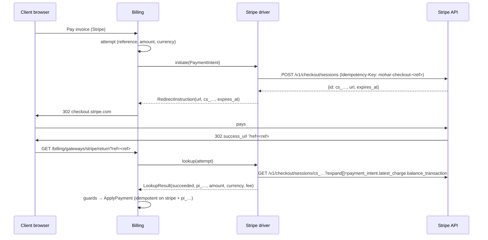

# Payments — Stripe gateway (design, v1)

Status: v1 built in `app/Modules/PaymentsStripe` (saved cards: second PR) · Owner: Billing (payments) · Roadmap 3.4 · Refines
`billing.md` §6 and follows the extension pattern of `payments-nepal.md` §8 · Stripe docs read 2026-10-18 (§9)

Clean-room: written from Stripe's public API reference and guides in our own words. No Stripe SDK is used; the
driver calls the REST API with Laravel's `Http` client. All ids and keys in this document and in the test fixtures
are made up.

## 1. Scope

**v1 (first PR):**

- One-off invoice payment through **Stripe Checkout** (hosted page, `mode=payment`): cards plus the wallets and
  methods Stripe enables for the account (Apple Pay and Google Pay ride on cards). The customer leaves our site
  only after we have created the session server-side.
- Settlement **only from a server-side retrieve** of the Checkout Session (with its PaymentIntent), matched
  against the stored attempt: amount, currency, our reference and an unused provider transaction id. Signed
  webhooks speed this up; every webhook triggers a retrieve and never trusts the posted body.
- Refunds, full and partial, through the Refunds API. Refunds made in the Stripe Dashboard are recorded from
  webhooks. Disputes are recorded as chargebacks and flagged for staff.
- Multi-currency: every card presentment currency Stripe lists (§5), including USD and INR, with zero-decimal
  currencies handled exactly.
- Admin configuration with write-only secrets, test mode, a connection test, the official Stripe wordmark.
- `php artisan payments:stripe-smoke`: a test-mode payment and refund against a real Stripe sandbox.

**Second PR (split for size):** saved cards and auto-capture: Checkout in `mode=setup`, the customer and
payment method ids stored encrypted, brand and last 4 shown, off-session PaymentIntents for renewals through the
existing auto-capture, and SCA "payment needs your action" handling (§7).

**Not in v1:** Stripe Billing subscriptions, Stripe Tax, Adaptive Pricing (turned off per session, §5), embedded
Checkout or Elements, Connect, dispute evidence submission, ACH/SEPA debits as saved methods, thin events.

## 2. Configuration (admin → Billing → Gateways → Stripe)

| Setting           | Type    | Notes                                                                                                         |
| ----------------- | ------- | ------------------------------------------------------------------------------------------------------------- |
| `sandbox`         | boolean | "Test mode", default on. Needs `sk_test_`/`rk_test_` keys. Refused where test money isn't allowed (§8).       |
| `secret_key`      | secret  | Required. `sk_…` or a restricted `rk_…` key of the selected mode. Write-only, encrypted in `gateways.config`. |
| `webhook_secret`  | secret  | Required. The endpoint's `whsec_…` signing secret. Write-only, encrypted.                                     |
| `publishable_key` | string  | Optional (`pk_…`). Checkout doesn't need it; the connection test checks that it belongs to the same mode.     |

- The edit page shows the webhook URL (`/billing/webhooks/stripe`, from Billing). Staff create a **snapshot**
  event destination in Stripe Workbench for the events in §4.
- **Test connection** retrieves the account (`GET /v1/account`). 200 → "Stripe accepted the secret key (test
  mode): <business name or acct id>". 401 → key rejected. A key whose prefix doesn't match the mode, a publishable
  key from the other mode, or a webhook secret without the `whsec_` prefix fail the check with a plain message.
  Nothing is created at Stripe.
- Logo: Stripe's official wordmark from its brand resources (§9), blurple on light, white on dark, unmodified.

## 3. Flows

### 3.1 Hosted payment



Session parameters: `mode=payment`, one line item with `price_data` (currency, `unit_amount` in Stripe units,
`product_data.name` "Invoice <number>"), `quantity=1`, `client_reference_id=<ref>`, `success_url` = Billing's
return URL plus `ref`, `cancel_url` = Billing's cancel URL, `customer_email` from the invoice snapshot,
`expires_at` = now + 35 minutes (Stripe allows 30 minutes to 24 hours), `adaptive_pricing[enabled]=false`, and
the same metadata on the session and on `payment_intent_data`: `mohar_reference`, `mohar_invoice_id`,
`mohar_amount` (Stripe units), `mohar_currency`, `mohar_flow=checkout`.

- The returned `url` must be `https://checkout.stripe.com/…` (exact host, no userinfo or port), otherwise the
  start fails and the attempt is closed.
- The attempt keeps Stripe's own `expires_at`, so the invoice stays locked only while the session can be paid.
- **Cancel:** Stripe's back button returns to the cancel URL. The driver then expires the session
  (`POST /v1/checkout/sessions/<id>/expire`; only an `open` session can be expired, so this can't touch a paid
  one) and the lookup closes the attempt at once, so the customer can pay another way without waiting 35 minutes.
  The session id comes from a server-side cache keyed by our reference, never from the browser.
- The poller (`billing.payments.reconcile`) settles attempts whose customer never came back.

### 3.2 Lookup status mapping

| Checkout Session (+ PaymentIntent)                            | LookupResult         | Attempt becomes                       |
| ------------------------------------------------------------- | -------------------- | ------------------------------------- |
| `complete` + `paid`, PI `succeeded`, nothing refunded         | succeeded            | succeeded (after Billing's guards)    |
| `complete` + `paid`, charge partly or fully refunded          | (partially_)refunded | staff review                          |
| `complete` + `unpaid` (delayed method still processing)       | pending              | pending                               |
| `open`                                                        | pending              | pending; review after TTL + grace     |
| `expired`                                                     | expired              | expired                               |
| reference, mode, livemode or metadata don't match the attempt | ambiguous            | staff review                          |
| `no_payment_required`, unknown status                         | ambiguous            | staff review                          |
| HTTP 404                                                      | not_found            | expired after TTL + grace             |
| HTTP 401/403                                                  | ambiguous            | staff review ("check the secret key") |
| HTTP 429/5xx, connection error                                | pending, retryable   | unchanged, polled again               |

`providerTxnId` is the PaymentIntent id (`pi_…`); refunds and disputes point back to it. The fee comes from the
charge's balance transaction, only when it is in the charge currency (otherwise 0, because a fee in the
settlement currency can't be booked against the invoice).

## 4. Webhooks

`POST /billing/webhooks/stripe` (Billing's route: CSRF-exempt, throttled). Order of checks, before anything is
stored:

1. `Stripe-Signature`: split on `,`, take `t` and every `v1` (ignore `v0` and other schemes). Expected =
   lowercase hex HMAC-SHA256 of `"<t>.<raw body>"` with the webhook secret. Compare with `hash_equals` against
   each `v1` (several appear while a secret is being rolled). No match → 403 "invalid signature".
2. Timestamp tolerance: `|now − t| ≤ 300 s`, else rejected as stale. Billing also checks the signed time.
3. JSON body with `id` (`evt_…`), `type`, `livemode` and `data.object.id`. `livemode` must match the gateway's
   mode, else rejected.
4. The object is **retrieved from Stripe** with our pinned API version. Only ids and the type come from the body,
   so the event's own API version doesn't matter.

| Event                                                                                                                                         | Retrieve      | Result for Billing                                                                                                            |
| --------------------------------------------------------------------------------------------------------------------------------------------- | ------------- | ----------------------------------------------------------------------------------------------------------------------------- |
| `checkout.session.completed`, `checkout.session.async_payment_succeeded`, `checkout.session.async_payment_failed`, `checkout.session.expired` | session       | settle the attempt named by our reference (Billing looks it up and applies its guards); sessions not created here are ignored |
| `payment_intent.succeeded`                                                                                                                    | PaymentIntent | the same, for PaymentIntents our Checkout created (`mohar_flow=checkout`)                                                     |
| `payment_intent.payment_failed`                                                                                                               | —             | acknowledged and logged; Checkout shows the failure and the customer can retry there                                          |
| `refund.created`, `refund.updated`                                                                                                            | refund        | refund recorded when `succeeded` and not made from our admin (`metadata.mohar_origin`); else ignored                          |
| `charge.dispute.created`                                                                                                                      | dispute       | chargeback (invoice → collections, `PaymentReversed`, staff see it in the gateway log and the invoice)                        |
| anything else (also `charge.refunded`)                                                                                                        | —             | 200, logged as ignored                                                                                                        |

- **Idempotency:** payments are unique on `(stripe, pi_…, payment)`, refunds on `re_…`, chargebacks on `du_…`
  (Billing's unique index). A replayed or duplicated delivery, or a webhook racing the return route or the
  poller, ends as "duplicate".
- **Webhook payments settle the attempt** (`CallbackEvent::ATTEMPT_UPDATED` carrying our reference): Billing runs
  the same `SettlePaymentAttempt` as the return route and the poller, so the amount, currency and exchange rate
  stored on the attempt are used. A webhook never records a payment from its own figures or a fresh exchange
  rate. A reference we never issued is acknowledged ("unknown attempt").
- Refunds and disputes are retrieved with their PaymentIntent expanded. One that has no `mohar_reference` was
  made by another integration on the same Stripe account and is acknowledged without booking, so Stripe doesn't
  retry it for days.
- `charge.refunded` is not used: its object is the charge, which doesn't say which refund is new. Stripe's own
  guidance is to listen to `refund.created`.
- Refunds made from our admin carry `metadata[mohar_origin]=admin`, so their webhooks are ignored and can't race
  the refund action into a second booking.

## 5. Amounts and currencies

- Our `Money` holds minor units per the currency's configured `decimals` (Core `currencies.decimals`, default 2).
  Stripe wants the "smallest currency unit": 0 decimals for BIF, CLP, DJF, GNF, JPY, KMF, KRW, MGA, PYG, RWF, VND,
  VUV, XAF, XOF, XPF; 2 for everything else. ISK and UGX are sent as 2-decimal values that must be whole units.
- `StripeAmount` converts by powers of ten and refuses any amount it can't express exactly (no rounding).
- Supported currencies: the card presentment list Stripe publishes (§9), 135 codes. UGX is excluded until its
  conflicting rules (listed as zero-decimal and as a 2-decimal special case) are confirmed in the sandbox.
  Three-decimal currencies (BHD, JOD, KWD, OMR, TND) are not in the list.
- Minimum: the driver advertises 50 minor units, which equals Stripe's minimum for USD, INR, EUR (0.50) and JPY,
  KRW (50). Stripe enforces the real minimum in the settlement currency; a refusal shows the usual "couldn't start
  the payment" message.
- Adaptive Pricing is turned off on every session, so the customer pays exactly the amount and currency we show.
  An invoice in an unsupported currency can still use Stripe through the gateway's `convert_to_currency`, and the
  converted amount and rate are shown before redirecting (Billing).

## 6. Refunds

- `POST /v1/refunds` with `payment_intent`, `amount` in Stripe units (always sent, even for a full refund) and
  `metadata[mohar_origin]=admin`. Partial refunds are supported: Stripe's unit is unambiguous.
- `succeeded` and `pending` count as accepted (the money is on its way). `failed`/`canceled` or an API error is
  declined with Stripe's message. No answer → error "check the Stripe Dashboard before retrying".
- A refund that later fails at Stripe arrives as `refund.updated` with status `failed`; it is logged for staff.
  Reversing an already booked refund is not automated in v1.

## 7. Saved payment methods and auto-capture (second PR, design revision 2)

Status: **proposed, revision 2** (2026-10-18). Revision 1 was reviewed by the architect on #58 (review 5562273636,
changes requested). This revision applies B1–B5 and the customer decision. The general rules are drafted as the
ADR 0012 addendum "Saved payment methods". The SCA email itself belongs to Notifications (#28); without it the new
event has no listener and the behaviour stays correct.

### 7.1 Kernel contract (opt-in capability interfaces, ADR 0012)

```php
namespace App\Contracts\Billing;

/**
 * Saves a payment method on the provider's own hosted page (Stripe Checkout mode=setup, PayPal vault approval,
 * Razorpay registration link). A driver implementing it must also declare CAPTURE (asserted by a test).
 */
interface HostedPayMethodSetup extends GatewayDriver
{
    /** How long the provider's setup session stays usable; drivers set this expiry explicitly at the provider. */
    public function setupTtl(GatewayConfig $gateway): CarbonInterval;

    /** Server-side: create the provider's setup session (and its customer, when $request->customerRef is null). */
    public function beginSetup(GatewayConfig $gateway, PayMethodSetupRequest $request): PayMethodSetupStart;

    /** Authoritative and repeatable: retrieve the setup by the stored provider ref. Never trusts the browser. */
    public function completeSetup(GatewayConfig $gateway, PayMethodSetupRef $setup): PayMethodSetupResult;

    /** Close an unfinished provider session (customer cancelled). Best effort. */
    public function cancelSetup(GatewayConfig $gateway, PayMethodSetupRef $setup): void;
}

/** Separate capability: forget a stored token at the provider (card removed, client erased). Best effort. */
interface RevokesStoredTokens
{
    public function revokeToken(GatewayConfig $gateway, string $token): void;
}
```

DTOs in `app/Data/Billing` (final, readonly) and one kernel enum:

| Type                      | Fields                                                                                                                                                                                     |
| ------------------------- | ------------------------------------------------------------------------------------------------------------------------------------------------------------------------------------------ |
| `PayMethodSetupRequest`   | `reference`, `clientId`, `?currency` (client currency), `?customerRef`, `returnUrl`, `cancelUrl`, `?customerEmail`, `?customerName`. Room for a trailing `?Money $maxAmount` (e-mandates). |
| `PayMethodSetupStart`     | `RedirectInstruction $instruction` (provider ref and expiry), `?customerRef` (set when the driver created a customer)                                                                      |
| `PayMethodSetupRef`       | `reference`, `clientId`, `?providerRef`, `?customerRef`, `?expiresAt`, `interactive`                                                                                                       |
| `PayMethodSetupResult`    | `status` (completed, pending, cancelled, expired, failed), `?token` (opaque), `PayMethodKind $kind`, `?brand`, `?last4`, `?expiryMonth`, `?expiryYear`, `?label`, `?customerRef`, `raw`    |
| `App\Enums\PayMethodKind` | `card`, `wallet`, `upi`, `bank` (`pay_methods.kind` gains `upi`)                                                                                                                           |

Compatible additions (ADR 0010, trailing and defaulted):

- `ChargeRequest`: `?string $attemptReference = null` (our attempt, B2) and `bool $merchantInitiated = false` (B3;
  auto-capture sets true, a charge the customer starts on the pay panel stays false).
- `ChargeResult` reason constants, documented as an open set: `REASON_AUTHENTICATION_REQUIRED`,
  `REASON_CARD_DECLINED`, `REASON_INVALID_TOKEN`, `REASON_PENDING_NOT_SUPPORTED` (the last three are already used as
  strings).
- Event `App\Events\Billing\PaymentAuthenticationRequired(int $invoiceId, int $clientId, string $gateway, int
$payMethodId)` in the ADR 0011 shape (final, after commit, occurrence id once `DomainEvent` lands, no URL in the
  payload). Notifications builds the invoice link.
- Kernel changelog entry and API snapshot note for all of the above.

`CardToken` and the TOKENIZE path stay as they are.

### 7.2 Billing: state in tables (B1, customers)

Migration (portable, foreign keys with explicit on-delete):

- `pay_method_setups`: `id`, `reference` (unique, 40), `gateway`, `mode` (test|live), `client_id` (cascade),
  `provider_ref` (nullable), `status` (pending|completed|cancelled|expired|failed), `expires_at`, `completed_at`,
  `pay_method_id` (nullable, null on delete), `created_by` (user, null on delete), `ip` (45), `consented_at`,
  `consent_text` (255, the wording the customer agreed to), `raw` (redacted json), timestamps. Index
  `(status, expires_at)` for the poller. It has the same shape and lifecycle as `payment_attempts`, and it is the
  consent record (who, when, which session) that merchant-initiated charges and dispute evidence rest on.
- `gateway_customers`: `id`, `client_id` (cascade), `gateway`, `mode`, `provider_customer_ref`, timestamps; unique
  `(client_id, gateway, mode)`. One provider customer per client, gateway and mode.
- `pay_methods`: soft deletes, so the consent trail survives a removal.
- `payment_attempts`: `flow` (checkout|charge, default checkout), `pay_method_id` (nullable, null on delete) and
  `merchant_initiated` (boolean).

Flow:

1. **Start:** `POST /client/payment-methods/setup/{gateway}` (client area, `ClientContext` billing permission,
   `throttle:billing-pay`, consent checkbox required). Billing creates the setup row (pending, `expires_at = now +
setupTtl()`), reads the client's `gateway_customers` ref, calls `beginSetup()`, stores the provider ref, and
   inserts the returned customer ref if there was none (`insertOrIgnore`; on a race the first ref wins, and the
   other setup still completes because the token names its own customer). Then `Inertia::location()`.
2. **Complete**, from three places that all call one action: the browser return
   (`GET /client/payment-methods/setup/{gateway}/return?ref=`, authenticated, the reference must belong to the
   current `ClientContext`), the reconcile poller (`billing:reconcile-payments` also walks pending setups until
   `expires_at` plus the lookup grace), and staff "Check now". Under `lockForUpdate` on the setup row, only a
   `pending → completed` transition stores a `pay_methods` row (kind, opaque token encrypted, brand, last 4, expiry,
   label; the first usable method becomes the default) and links it. A second completion finds the row completed and
   does nothing. A result's `customerRef` that differs from the stored one replaces it (the provider lost the old
   customer, for example after staff switched accounts).
3. **Cancel return:** `cancelSetup()`, status cancelled. Expired or failed results close the row.
4. **Webhooks:** setup sessions are acknowledged as ignored ("setup session, completed by the return or the
   poller"), not as "unknown attempt".
5. **Removal:** soft-delete the pay method, then a queued job calls `revokeToken()` when the driver implements
   `RevokesStoredTokens` (`report()` on failure).

### 7.3 Billing: charges recorded before the call (B2)

For a gateway whose driver is a `HostedPaymentDriver` and declares `CAPTURE`, every charge of a stored method
(auto-capture, a saved method chosen on the pay panel, `PaymentBatches`) works like this:

1. Billing creates a `payment_attempts` row first (`flow=charge`, pending, `pay_method_id`, charge amount, currency
   and rate, `merchant_initiated`, `expires_at = now + billing.gateways.charge_attempt_hours`, default 48, because a
   card mandate can stay pending for a day or more).
2. It calls `capture()` with `attemptReference` set. The driver derives its idempotency key from it
   (`mohar-charge-<reference>`) and sends the reference to the provider (Stripe metadata).
3. `SUCCESS` settles the attempt through the same code as `SettlePaymentAttempt::succeed()` (guards included).
   `PENDING` keeps it open with the provider ref, and `ATTEMPT_UPDATED` webhooks and the poller settle it. `DECLINED`
   fails it.
4. **`ERROR` or no answer leaves the attempt pending; it is not counted as a decline.** While `providerRef` is null,
   the poller repeats the identical `capture()` request (same reference, so the same idempotency key) for up to 24
   hours. The provider replays its stored answer or performs the charge once, so a crash between the provider's
   success and `ApplyPayment` can't lead to a second charge. Past 24 hours the attempt goes to staff review. A
   provider without idempotent creates must implement `lookup()` by our reference instead. Stripe search can't do
   that: it isn't available to businesses in India and lags about a minute.
5. While a charge attempt is open, auto-capture skips the invoice. This is the same `PaymentInProgress` rule as for
   checkout attempts.

### 7.4 Billing: who started the charge, and SCA (B3, B5)

- **Stored token only.** For a gateway implementing `HostedPayMethodSetup`, `ClientPaymentOptions::resolveForClient()`
  accepts only a `pay_method_id` scoped to the client, never a `token` from the request. `kind()` stays `redirect`
  for every `HostedPaymentDriver`; the pay panel lists that gateway's saved methods above "Pay with a new card on
  Stripe".
- **`merchantInitiated`:** true for auto-capture, false for a method the customer picks. The driver maps it
  (Stripe: `off_session=true` vs an on-session confirm with `error_on_requires_action=true`).
- **Authentication required:**
    - On-session (customer-initiated): Billing fails the charge attempt and falls straight through to
      `StartHostedPayment`, so the hosted page runs the challenge.
    - Merchant-initiated: the attempt fails, the decline doesn't count toward `max_failures_per_pay_method`, Billing
      dispatches `PaymentAuthenticationRequired` once per invoice, and auto-capture skips that invoice and pay method
      until the invoice is paid (repeating gets the same answer).
- Add-funds and `forClient()`'s `selected_gateway`: Stripe becomes capture-eligible, so a test checks that add-funds
  still redirects.

### 7.5 Stripe driver

- `setupTtl`: 35 minutes, sent as the session's `expires_at`.
- `beginSetup`: without a customer ref, `POST /v1/customers` (`metadata[mohar_client_id]`, idempotency
  `mohar-customer-<setup ref>`). Then a Checkout Session `mode=setup` with `customer`, `currency` (required in
  setup mode without explicit method types), `client_reference_id`, `expires_at`, `metadata` and
  `setup_intent_data[metadata]` (our reference and client id), idempotency `mohar-setup-<ref>`. A "No such customer"
  answer creates a new customer and returns its ref.
- `completeSetup`: retrieve the session with `setup_intent.payment_method` expanded. `complete` + SetupIntent
  `succeeded` + our reference + `metadata.mohar_client_id == clientId` + the expected customer → completed, with token
  `cus_…|pm_…` (opaque to Billing). Kind is `card` for `card`, and `wallet` for wallet types such as `link`. `open`
  maps to pending and `expired` to expired; any mismatch fails it.
- `cancelSetup`: `POST /v1/checkout/sessions/{id}/expire`.
- `capture`: `POST /v1/payment_intents` with `customer`, `payment_method`, `amount`, `currency`, `confirm=true`, and
  metadata (`mohar_reference`, `mohar_flow=charge`, invoice id, amount, currency).
    - Merchant-initiated sends `off_session=true`; customer-initiated sends `error_on_requires_action=true`.
    - Idempotency `mohar-charge-<attemptReference>`.
    - `succeeded` → success. `processing` → pending. HTTP 402 `authentication_required`, or `requires_action` →
      declined with `REASON_AUTHENTICATION_REQUIRED`. Other card errors → declined with the decline code.
- `lookup` accepts a `pi_…` provider ref as well as `cs_…`. PaymentIntent events with `mohar_flow=charge` become
  `ATTEMPT_UPDATED`.
- `RevokesStoredTokens::revokeToken`: `POST /v1/payment_methods/{pm}/detach`.
- Card numbers never reach our servers: card entry happens only on Stripe's pages.

## 8. Security

- Secrets only in `gateways.config` (encrypted array); never in Inertia props, logs, exceptions or `raw`.
  Stored payloads keep ids, statuses, amounts and Stripe's error code/type, nothing else.
- Every call: `Authorization: Bearer <secret>`, `Stripe-Version: 2026-09-30.endive`, TLS verification on, pinned
  host `https://api.stripe.com/v1/`, 5 s connect and `billing.gateways.http_timeout_seconds` total timeout. Every
  `POST` sends an `Idempotency-Key` (`mohar-checkout-<ref>` for sessions; a random UUID per refund, because two
  equal partial refunds are legitimate). POSTs are never retried automatically; background lookups retry on
  connection errors and 5xx.
- Test mode follows `SandboxPolicy`: never activatable, offered or chargeable in production, and the driver itself
  refuses test mode there. Keys are checked against the mode (`sk_test_`/`rk_test_` vs `sk_live_`/`rk_live_`).
- Webhooks: constant-time signature check, 5-minute tolerance, livemode check, retrieve before acting.
- Return and cancel URLs are built from route names; the reference is validated (`[a-z0-9-]{3,40}`).

## 9. Acceptance criteria

1. MUST: Given an unpaid USD invoice of $25.00, when the client pays with Stripe, a Checkout Session is created
   with `unit_amount=2500`, `currency=usd`, our reference, an idempotency key and the pinned version, and the
   client is redirected to `checkout.stripe.com`.
2. MUST: Given the client returns, the invoice is paid only after the session retrieve reports `complete`/`paid`
   with amount 2500 USD and our reference; the transaction id is the PaymentIntent id and the fee is recorded.
3. MUST: Given a retrieve with a different amount, currency or reference, no payment is recorded and the attempt
   goes to staff review.
4. MUST: Given a webhook with a valid signature, a tampered body, a wrong secret, a timestamp older than 5 minutes,
   or a replay of an already processed event, only the valid first delivery causes a retrieve, and only one
   transaction exists in the end.
5. MUST: Given the return, the poller and two webhooks for the same payment in any order, exactly one transaction
   exists and `InvoicePaid` fires once.
6. MUST: Given a paid Stripe payment, staff can refund part of it and then the rest through Stripe; the refund
   webhooks for those refunds don't book them again.
7. MUST: Given a refund made in the Stripe Dashboard, `refund.created` records it once.
8. MUST: Given `charge.dispute.created`, a chargeback is recorded, the invoice goes to collections and
   `PaymentReversed` fires.
9. MUST: Given production, test mode can't be activated or used, and the driver refuses test-mode calls.
10. MUST: Given a JPY invoice of ¥5,000 (0 decimals), Stripe receives `unit_amount=5000`; given an amount that can't
    be expressed exactly in Stripe units, the payment doesn't start.
11. MUST: Secrets never appear in Inertia props, the gateway log or stored payloads.
12. MUST: The connection test reports a rejected key, a key of the wrong mode and success, without creating
    anything at Stripe.
13. MUST: `payments:stripe-smoke` runs a test-mode payment and a partial plus full refund against real test keys,
    refuses live keys, and prints no secret.
14. SHOULD: Cancelling on Stripe's page unlocks the invoice at once.

## 10. Sources (read 2026-10-18)

API version `2026-09-30.endive` is the current version stated on the versioning page on 2026-10-18.

- Versioning and `Stripe-Version`: https://docs.stripe.com/api/versioning
- Authentication and key prefixes: https://docs.stripe.com/api/authentication
- Idempotent requests (keys up to 255 characters, all v1 `POST`s accept them, results kept at least 24 h):
  https://docs.stripe.com/api/idempotent_requests
- Errors and HTTP codes: https://docs.stripe.com/api/errors
- Expanding responses (`expand[]`, up to four levels): https://docs.stripe.com/api/expanding_objects
- Metadata (50 keys, 40-character keys, 500-character values): https://docs.stripe.com/api/metadata
- Checkout Sessions create, object, retrieve, expire: https://docs.stripe.com/api/checkout/sessions/create ,
  https://docs.stripe.com/api/checkout/sessions/object , https://docs.stripe.com/api/checkout/sessions/retrieve ,
  https://docs.stripe.com/api/checkout/sessions/expire
- PaymentIntents object and create: https://docs.stripe.com/api/payment_intents/object ,
  https://docs.stripe.com/api/payment_intents/create
- Refunds object and create: https://docs.stripe.com/api/refunds/object , https://docs.stripe.com/api/refunds/create
- Disputes object: https://docs.stripe.com/api/disputes/object
- Balance transactions: https://docs.stripe.com/api/balance_transactions/object
- Event types: https://docs.stripe.com/api/events/types
- Webhooks, manual signature verification, retries: https://docs.stripe.com/webhooks (section "Verify webhook
  signatures manually"), https://docs.stripe.com/webhooks/signature
- Currencies, zero-decimal list, special cases, minimums: https://docs.stripe.com/currencies (presentment list as
  rendered for the India tab on 2026-10-18)
- Test cards and payment methods (`pm_card_visa`, decline and authentication cards): https://docs.stripe.com/testing
- Brand resources and logo kit: https://stripe.com/newsroom/brand-assets (kit:
  `Stripe_logo_kit.zip` → `Stripe wordmark - Blurple.svg`, `Stripe wordmark - White.svg`); use is subject to
  Stripe's Marks Usage Agreement linked there.
- Observed 2026-10-18: `GET https://api.stripe.com/v1/account` with an invalid test key answers 401 "Invalid API
  Key provided"; an unknown path answers 404 "Unrecognized request URL". The account-retrieve reference page shows
  only `/v1/accounts/{id}`, so the own-account form is taken from this observation.
