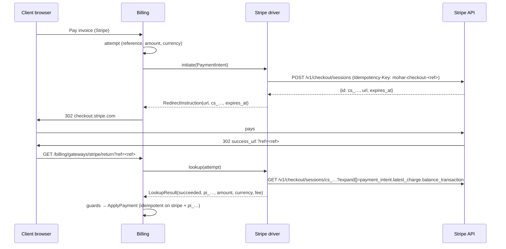

# Payments — Stripe gateway (design, v1)

Status: designed, build in `app/Modules/PaymentsStripe` · Owner: Billing (payments) · Roadmap 3.4 · Refines
`billing.md` §6 and follows the extension pattern of `payments-nepal.md` §8 · Stripe docs read 2026-10-18 (§9)

Clean-room: written from Stripe's public API reference and guides in our own words. No Stripe SDK is used; the
driver calls the REST API with Laravel's `Http` client. All ids and keys in this document and in the test fixtures
are made up.

## 1. Scope

**v1 (first PR):**

- One-off invoice payment through **Stripe Checkout** (hosted page, `mode=payment`): cards plus the wallets and
  methods Stripe enables for the account (Apple Pay and Google Pay ride on cards). The customer leaves our site
  only after we have created the session server-side.
- Settlement **only from a server-side retrieve** of the Checkout Session (with its PaymentIntent), matched
  against the stored attempt: amount, currency, our reference and an unused provider transaction id. Signed
  webhooks speed this up; every webhook triggers a retrieve and never trusts the posted body.
- Refunds, full and partial, through the Refunds API. Refunds made in the Stripe Dashboard are recorded from
  webhooks. Disputes are recorded as chargebacks and flagged for staff.
- Multi-currency: every card presentment currency Stripe lists (§5), including USD and INR, with zero-decimal
  currencies handled exactly.
- Admin configuration with write-only secrets, test mode, a connection test, the official Stripe wordmark.
- `php artisan payments:stripe-smoke`: a test-mode payment and refund against a real Stripe sandbox.

**Second PR (split for size):** saved cards and auto-capture: Checkout in `mode=setup`, the customer and
payment method ids stored encrypted, brand and last 4 shown, off-session PaymentIntents for renewals through the
existing auto-capture, and SCA "payment needs your action" handling (§7).

**Not in v1:** Stripe Billing subscriptions, Stripe Tax, Adaptive Pricing (turned off per session, §5), embedded
Checkout or Elements, Connect, dispute evidence submission, ACH/SEPA debits as saved methods, thin events.

## 2. Configuration (admin → Billing → Gateways → Stripe)

| Setting           | Type    | Notes                                                                                                         |
| ----------------- | ------- | ------------------------------------------------------------------------------------------------------------- |
| `sandbox`         | boolean | "Test mode", default on. Needs `sk_test_`/`rk_test_` keys. Refused where test money isn't allowed (§8).       |
| `secret_key`      | secret  | Required. `sk_…` or a restricted `rk_…` key of the selected mode. Write-only, encrypted in `gateways.config`. |
| `webhook_secret`  | secret  | Required. The endpoint's `whsec_…` signing secret. Write-only, encrypted.                                     |
| `publishable_key` | string  | Optional (`pk_…`). Checkout doesn't need it; the connection test checks that it belongs to the same mode.     |

- The edit page shows the webhook URL (`/billing/webhooks/stripe`, from Billing). Staff create a **snapshot**
  event destination in Stripe Workbench for the events in §4.
- **Test connection** retrieves the account (`GET /v1/account`). 200 → "Stripe accepted the secret key (test
  mode): <business name or acct id>". 401 → key rejected. A key whose prefix doesn't match the mode, a publishable
  key from the other mode, or a webhook secret without the `whsec_` prefix fail the check with a plain message.
  Nothing is created at Stripe.
- Logo: Stripe's official wordmark from its brand resources (§9), blurple on light, white on dark, unmodified.

## 3. Flows

### 3.1 Hosted payment

Session parameters: `mode=payment`, one line item with `price_data` (currency, `unit_amount` in Stripe units,
`product_data.name` "Invoice <number>"), `quantity=1`, `client_reference_id=<ref>`, `success_url` = Billing's
return URL plus `ref`, `cancel_url` = Billing's cancel URL, `customer_email` from the invoice snapshot,
`expires_at` = now + 35 minutes (Stripe allows 30 minutes to 24 hours), `adaptive_pricing[enabled]=false`, and
the same metadata on the session and on `payment_intent_data`: `mohar_reference`, `mohar_invoice_id`,
`mohar_amount` (Stripe units), `mohar_currency`, `mohar_flow=checkout`.

- The returned `url` must be `https://checkout.stripe.com/…` (exact host, no userinfo or port), otherwise the
  start fails and the attempt is closed.
- The attempt keeps Stripe's own `expires_at`, so the invoice stays locked only while the session can be paid.
- **Cancel:** Stripe's back button returns to the cancel URL. The driver then expires the session
  (`POST /v1/checkout/sessions/<id>/expire`; only an `open` session can be expired, so this can't touch a paid
  one) and the lookup closes the attempt at once, so the customer can pay another way without waiting 35 minutes.
  The session id comes from a server-side cache keyed by our reference, never from the browser.
- The poller (`billing.payments.reconcile`) settles attempts whose customer never came back.

### 3.2 Lookup status mapping

| Checkout Session (+ PaymentIntent)                            | LookupResult         | Attempt becomes                       |
| ------------------------------------------------------------- | -------------------- | ------------------------------------- |
| `complete` + `paid`, PI `succeeded`, nothing refunded         | succeeded            | succeeded (after Billing's guards)    |
| `complete` + `paid`, charge partly or fully refunded          | (partially_)refunded | staff review                          |
| `complete` + `unpaid` (delayed method still processing)       | pending              | pending                               |
| `open`                                                        | pending              | pending; review after TTL + grace     |
| `expired`                                                     | expired              | expired                               |
| reference, mode, livemode or metadata don't match the attempt | ambiguous            | staff review                          |
| `no_payment_required`, unknown status                         | ambiguous            | staff review                          |
| HTTP 404                                                      | not_found            | expired after TTL + grace             |
| HTTP 401/403                                                  | ambiguous            | staff review ("check the secret key") |
| HTTP 429/5xx, connection error                                | pending, retryable   | unchanged, polled again               |

`providerTxnId` is the PaymentIntent id (`pi_…`); refunds and disputes point back to it. The fee comes from the
charge's balance transaction, only when it is in the charge currency (otherwise 0, because a fee in the
settlement currency can't be booked against the invoice).

## 4. Webhooks

`POST /billing/webhooks/stripe` (Billing's route: CSRF-exempt, throttled). Order of checks, before anything is
stored:

1. `Stripe-Signature`: split on `,`, take `t` and every `v1` (ignore `v0` and other schemes). Expected =
   lowercase hex HMAC-SHA256 of `"<t>.<raw body>"` with the webhook secret. Compare with `hash_equals` against
   each `v1` (several appear while a secret is being rolled). No match → 403 "invalid signature".
2. Timestamp tolerance: `|now − t| ≤ 300 s`, else rejected as stale. Billing also checks the signed time.
3. JSON body with `id` (`evt_…`), `type`, `livemode` and `data.object.id`. `livemode` must match the gateway's
   mode, else rejected.
4. The object is **retrieved from Stripe** with our pinned API version. Only ids and the type come from the body,
   so the event's own API version doesn't matter.

| Event                                                                                                | Retrieve                  | Result for Billing                                                                                       |
| ---------------------------------------------------------------------------------------------------- | ------------------------- | -------------------------------------------------------------------------------------------------------- |
| `checkout.session.completed`, `checkout.session.async_payment_succeeded`                             | session (+ PaymentIntent) | payment succeeded, when paid and the PI matches our metadata (amount, currency, reference); else ignored |
| `payment_intent.succeeded`                                                                           | PaymentIntent             | payment succeeded (same txn id as above, so duplicates are no-ops)                                       |
| `payment_intent.payment_failed`, `checkout.session.expired`, `checkout.session.async_payment_failed` | —                         | acknowledged and logged; Checkout shows the failure itself and the poller closes the attempt by lookup   |
| `refund.created`, `refund.updated`                                                                   | refund                    | refund recorded when `succeeded` and not made from our admin (`metadata.mohar_origin`); else ignored     |
| `charge.dispute.created`                                                                             | dispute                   | chargeback (invoice → collections, `PaymentReversed`, staff see it in the gateway log and the invoice)   |
| anything else (also `charge.refunded`)                                                               | —                         | 200, logged as ignored                                                                                   |

- **Idempotency:** payments are unique on `(stripe, pi_…, payment)`, refunds on `re_…`, chargebacks on `du_…`
  (Billing's unique index). A replayed or duplicated delivery, or a webhook racing the return route or the
  poller, ends as "duplicate".
- **Amount guard on the webhook path:** the PaymentIntent's `amount_received` and `currency` must equal the
  `mohar_amount`/`mohar_currency` we wrote when creating the session. The retrieved session must carry our
  reference in both `client_reference_id` and metadata.
- `charge.refunded` is not used: its object is the charge, which doesn't say which refund is new. Stripe's own
  guidance is to listen to `refund.created`.
- Refunds made from our admin carry `metadata[mohar_origin]=admin`, so their webhooks are ignored and can't race
  the refund action into a second booking.

## 5. Amounts and currencies

- Our `Money` holds minor units per the currency's configured `decimals` (Core `currencies.decimals`, default 2).
  Stripe wants the "smallest currency unit": 0 decimals for BIF, CLP, DJF, GNF, JPY, KMF, KRW, MGA, PYG, RWF, VND,
  VUV, XAF, XOF, XPF; 2 for everything else. ISK and UGX are sent as 2-decimal values that must be whole units.
- `StripeAmount` converts by powers of ten and refuses any amount it can't express exactly (no rounding).
- Supported currencies: the card presentment list Stripe publishes (§9), 135 codes. UGX is excluded until its
  conflicting rules (listed as zero-decimal and as a 2-decimal special case) are confirmed in the sandbox.
  Three-decimal currencies (BHD, JOD, KWD, OMR, TND) are not in the list.
- Minimum: the driver advertises 50 minor units, which equals Stripe's minimum for USD, INR, EUR (0.50) and JPY,
  KRW (50). Stripe enforces the real minimum in the settlement currency; a refusal shows the usual "couldn't start
  the payment" message.
- Adaptive Pricing is turned off on every session, so the customer pays exactly the amount and currency we show.
  An invoice in an unsupported currency can still use Stripe through the gateway's `convert_to_currency`, and the
  converted amount and rate are shown before redirecting (Billing).

## 6. Refunds

- `POST /v1/refunds` with `payment_intent`, `amount` in Stripe units (always sent, even for a full refund) and
  `metadata[mohar_origin]=admin`. Partial refunds are supported: Stripe's unit is unambiguous.
- `succeeded` and `pending` count as accepted (the money is on its way). `failed`/`canceled` or an API error is
  declined with Stripe's message. No answer → error "check the Stripe Dashboard before retrying".
- A refund that later fails at Stripe arrives as `refund.updated` with status `failed`; it is logged for staff.
  Reversing an already booked refund is not automated in v1.

## 7. Saved cards and auto-capture (second PR)

- Card setup: Checkout `mode=setup` with `customer` (created once per client, metadata `mohar_client_id`) and
  `setup_intent_data.metadata`. After the return, the SetupIntent and PaymentMethod are retrieved server-side;
  the stored token holds `cus_…` and `pm_…` (encrypted with the pay method), plus brand, last 4 and expiry.
- Renewals: `POST /v1/payment_intents` with `customer`, `payment_method`, `confirm=true`, `off_session=true`.
  `succeeded` → success; `processing` → pending (settled by `payment_intent.succeeded`); a card decline → declined
  with the decline code; `authentication_required` (SCA) → declined with reason `authentication_required`, which
  Billing's `PaymentFailed` carries to the customer as "your bank needs you to confirm this payment" with a link
  to the invoice, where Checkout handles 3-D Secure.
- Card numbers never reach our servers: card entry happens only on Stripe's pages.

## 8. Security

- Secrets only in `gateways.config` (encrypted array); never in Inertia props, logs, exceptions or `raw`.
  Stored payloads keep ids, statuses, amounts and Stripe's error code/type, nothing else.
- Every call: `Authorization: Bearer <secret>`, `Stripe-Version: 2026-09-30.endive`, TLS verification on, pinned
  host `https://api.stripe.com/v1/`, 5 s connect and `billing.gateways.http_timeout_seconds` total timeout. Every
  `POST` sends an `Idempotency-Key` (`mohar-checkout-<ref>` for sessions; a random UUID per refund, because two
  equal partial refunds are legitimate). POSTs are never retried automatically; background lookups retry on
  connection errors and 5xx.
- Test mode follows `SandboxPolicy`: never activatable, offered or chargeable in production, and the driver itself
  refuses test mode there. Keys are checked against the mode (`sk_test_`/`rk_test_` vs `sk_live_`/`rk_live_`).
- Webhooks: constant-time signature check, 5-minute tolerance, livemode check, retrieve before acting.
- Return and cancel URLs are built from route names; the reference is validated (`[a-z0-9-]{3,40}`).

## 9. Acceptance criteria

1. MUST: Given an unpaid USD invoice of $25.00, when the client pays with Stripe, a Checkout Session is created
   with `unit_amount=2500`, `currency=usd`, our reference, an idempotency key and the pinned version, and the
   client is redirected to `checkout.stripe.com`.
2. MUST: Given the client returns, the invoice is paid only after the session retrieve reports `complete`/`paid`
   with amount 2500 USD and our reference; the transaction id is the PaymentIntent id and the fee is recorded.
3. MUST: Given a retrieve with a different amount, currency or reference, no payment is recorded and the attempt
   goes to staff review.
4. MUST: Given a webhook with a valid signature, a tampered body, a wrong secret, a timestamp older than 5 minutes,
   or a replay of an already processed event, only the valid first delivery causes a retrieve, and only one
   transaction exists in the end.
5. MUST: Given the return, the poller and two webhooks for the same payment in any order, exactly one transaction
   exists and `InvoicePaid` fires once.
6. MUST: Given a paid Stripe payment, staff can refund part of it and then the rest through Stripe; the refund
   webhooks for those refunds don't book them again.
7. MUST: Given a refund made in the Stripe Dashboard, `refund.created` records it once.
8. MUST: Given `charge.dispute.created`, a chargeback is recorded, the invoice goes to collections and
   `PaymentReversed` fires.
9. MUST: Given production, test mode can't be activated or used, and the driver refuses test-mode calls.
10. MUST: Given a JPY invoice of ¥5,000 (0 decimals), Stripe receives `unit_amount=5000`; given an amount that can't
    be expressed exactly in Stripe units, the payment doesn't start.
11. MUST: Secrets never appear in Inertia props, the gateway log or stored payloads.
12. MUST: The connection test reports a rejected key, a key of the wrong mode and success, without creating
    anything at Stripe.
13. MUST: `payments:stripe-smoke` runs a test-mode payment and a partial plus full refund against real test keys,
    refuses live keys, and prints no secret.
14. SHOULD: Cancelling on Stripe's page unlocks the invoice at once.

## 10. Sources (read 2026-10-18)

API version `2026-09-30.endive` is the current version stated on the versioning page on 2026-10-18.

- Versioning and `Stripe-Version`: https://docs.stripe.com/api/versioning
- Authentication and key prefixes: https://docs.stripe.com/api/authentication
- Idempotent requests (keys up to 255 characters, all v1 `POST`s accept them, results kept at least 24 h):
  https://docs.stripe.com/api/idempotent_requests
- Errors and HTTP codes: https://docs.stripe.com/api/errors
- Expanding responses (`expand[]`, up to four levels): https://docs.stripe.com/api/expanding_objects
- Metadata (50 keys, 40-character keys, 500-character values): https://docs.stripe.com/api/metadata
- Checkout Sessions create, object, retrieve, expire: https://docs.stripe.com/api/checkout/sessions/create ,
  https://docs.stripe.com/api/checkout/sessions/object , https://docs.stripe.com/api/checkout/sessions/retrieve ,
  https://docs.stripe.com/api/checkout/sessions/expire
- PaymentIntents object and create: https://docs.stripe.com/api/payment_intents/object ,
  https://docs.stripe.com/api/payment_intents/create
- Refunds object and create: https://docs.stripe.com/api/refunds/object , https://docs.stripe.com/api/refunds/create
- Disputes object: https://docs.stripe.com/api/disputes/object
- Balance transactions: https://docs.stripe.com/api/balance_transactions/object
- Event types: https://docs.stripe.com/api/events/types
- Webhooks, manual signature verification, retries: https://docs.stripe.com/webhooks (section "Verify webhook
  signatures manually"), https://docs.stripe.com/webhooks/signature
- Currencies, zero-decimal list, special cases, minimums: https://docs.stripe.com/currencies (presentment list as
  rendered for the India tab on 2026-10-18)
- Test cards and payment methods (`pm_card_visa`, decline and authentication cards): https://docs.stripe.com/testing
- Brand resources and logo kit: https://stripe.com/newsroom/brand-assets (kit:
  `Stripe_logo_kit.zip` → `Stripe wordmark - Blurple.svg`, `Stripe wordmark - White.svg`); use is subject to
  Stripe's Marks Usage Agreement linked there.
- Observed 2026-10-18: `GET https://api.stripe.com/v1/account` with an invalid test key answers 401 "Invalid API
  Key provided"; an unknown path answers 404 "Unrecognized request URL". The account-retrieve reference page shows
  only `/v1/accounts/{id}`, so the own-account form is taken from this observation.
