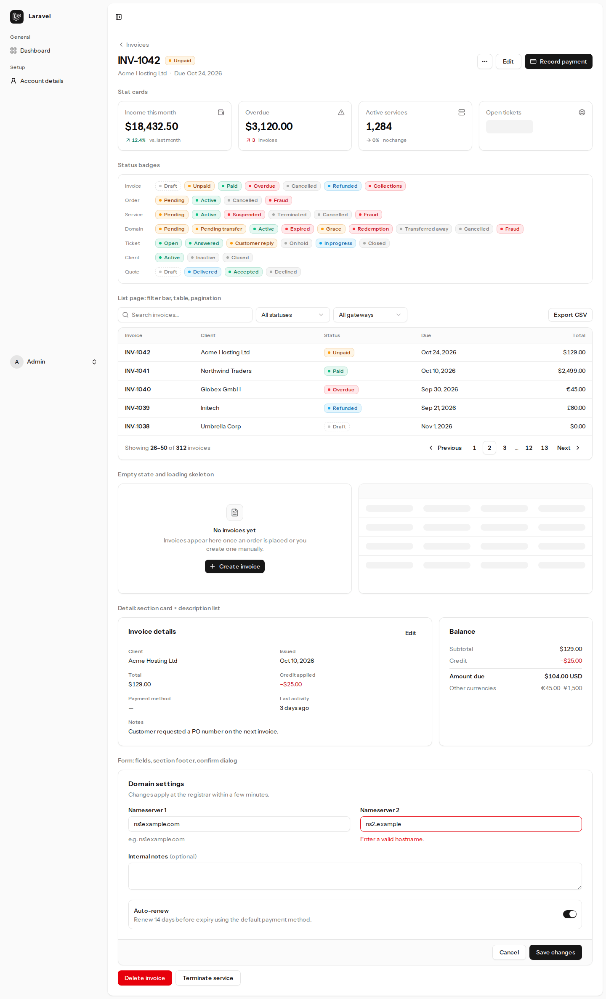

# Build Progress

Living status board. Each workstream updates its row when it opens a PR for review. Screenshots live in
`docs/screenshots/` (captured with headless Playwright against a running instance).

| Workstream                                        | Owner (agent)           | Branch / PR                                    | Status                                 | Notes                                                                                                                                                                                              |
| ------------------------------------------------- | ----------------------- | ---------------------------------------------- | -------------------------------------- | -------------------------------------------------------------------------------------------------------------------------------------------------------------------------------------------------- |
| Foundation & Core                                 | CTO                     | `develop`                                      | ✅ merged                              | shared kernel, contracts v2 (ADR 0008)                                                                                                                                                             |
| Design system & shared UI                         | Senior Product Designer | `develop`                                      | ✅ merged                              | 15 components                                                                                                                                                                                      |
| Product specs (14 modules)                        | PMs + architects        | `develop`                                      | ✅ merged                              | `docs/product/*.md` incl. AI, migration, Nepal payments, registrars                                                                                                                                |
| DevOps: Postgres + CI                             | DevOps Engineer         | #1                                             | ✅ merged                              | SQLite + PostgreSQL in CI                                                                                                                                                                          |
| Dependency policy + CI minutes                    | DevOps Engineer         | #9                                             | ✅ merged                              | exact pins, ≥7-day cooldown, ~2 min/run                                                                                                                                                            |
| Domains                                           | Senior Engineer         | #5                                             | ✅ merged                              | 171 tests; follow-ups #12–#15                                                                                                                                                                      |
| Catalog                                           | Senior Engineer         | #4                                             | ✅ merged                              | 477 suite tests at merge; follow-up #16                                                                                                                                                            |
| Platform admin + security tier                    | Senior Engineer         | #3                                             | ✅ merged                              | 628 suite tests at merge                                                                                                                                                                           |
| Support                                           | Senior Engineer         | #6                                             | ✅ merged                              |                                                                                                                                                                                                    |
| Services & Provisioning                           | Senior Engineer         | #7                                             | ✅ merged                              |                                                                                                                                                                                                    |
| Orders                                            | Senior Engineer         | #8                                             | ✅ merged                              | 1464 suite tests at merge                                                                                                                                                                          |
| Billing                                           | Senior Engineer         | #10                                            | ✅ merged                              | security + money integrity + GST tax invoice; follow-ups PR #22                                                                                                                                    |
| Themes module + Mohar brand                       | Principal Designer      | #17                                            | ✅ merged                              | Calm Fintech default, custom themes, brand settings                                                                                                                                                |
| Billing follow-ups                                | Senior Engineer         | #22                                            | ✅ merged                              | exact quote conversion (#20), demo history; follow-ups #23                                                                                                                                         |
| Notifications                                     | Senior Engineer         | #28                                            | ✅ merged                              | branded mail layout, templates, webhooks; private links only to their owner                                                                                                                        |
| Email direction A (Notifications follow-up)       | Senior Engineer         | #72                                            | ✅ merged                              | two-card layout for every email, framework mail through templates, sweep fixes; screenshots in `docs/screenshots/notifications/direction-a/`                                                       |
| Affiliates                                        | Senior Engineer         | —                                              | ⏳ wave 2                              |                                                                                                                                                                                                    |
| Nepal payment drivers (Khalti, eSewa, ConnectIPS) | Senior Engineer         | #26                                            | ✅ merged                              | Khalti and eSewa; ConnectIPS later; follow-ups #27                                                                                                                                                 |
| Dashboard v2                                      | Principal Designer      | #41                                            | ✅ merged                              | KPI cards, charts, Automation page summary                                                                                                                                                         |
| Product polish sweep 1                            | Product reviewer        | #38                                            | ✅ merged                              |                                                                                                                                                                                                    |
| Database hardening (audit 1)                      | Database reviewer       | #53                                            | ✅ merged                              | 55 indexes, paging fix in automation                                                                                                                                                               |
| Currencies and exchange rates                     | Senior Engineer         | #43                                            | ✅ merged                              | symbols, lakh grouping, rate sources, reviews, converted prices                                                                                                                                    |
| Production install path                           | Senior Engineer         | #57                                            | ✅ merged                              | `app:install`, reference-data installers                                                                                                                                                           |
| Kernel contracts (ADR 0009 PR A)                  | Senior Engineer         | #61                                            | ✅ merged                              | outbound address guard, Redactor, SettingField, driver registry                                                                                                                                    |
| Provisioning on kernel (ADR 0009 PR B, B2)        | Senior Engineer         | #62                                            | ✅ merged                              | base for the cPanel/WHM driver                                                                                                                                                                     |
| Stripe gateway                                    | Senior Engineer         | #58                                            | ✅ merged                              | fixture-tested, not live-verified; simulator in S3                                                                                                                                                 |
| cPanel/WHM driver                                 | Senior Engineer         | #69, #73                                       | ✅ 1a+1b merged                        | spec: provisioning-cpanel.md; after #62                                                                                                                                                            |
| Registrar drivers (.np, ResellerClub, Namecheap)  | Senior Engineer         | #199, #262, #264, #265, #325, #332, #335, #376 | ✅ .np, ResellerClub, Namecheap merged | .np: clients register at the registry, Mohar shows nameservers; ResellerClub driver and simulator merged; Namecheap simulator (#373) and driver (#376) merged, not enabled until the sandbox check |
| Client importer (CSV, WHMCS preset)               | Senior Engineers        | #160–#163, #184, #201                          | ✅ merged                              | upload, map, review, confirm and apply, report; B2 merged (invitations #255, opening balances #259)                                                                                                |
| eSewa and Khalti simulators                       | Senior Engineer         | #321                                           | ✅ merged                              | NPR lifecycle end to end (closes #208); follow-ups #322, #323                                                                                                                                      |
| Flaky-test fixes                                  | Senior Engineer         | #326, #331                                     | ✅ merged                              | time boundaries (#310, #322), simulator ports (#209)                                                                                                                                               |
| Nepal-first demo seed, #39 fix                    | Senior Engineer         | #330                                           | ✅ merged                              | NPR demo data, seeded invoice dates                                                                                                                                                                |
| VAT register and credit-note spec                 | Product manager         | #327, #329                                     | ✅ merged                              | spec and ADR 0024/0025; build starts with the company clock (#337)                                                                                                                                 |
| Company clock (VAT PR 0a)                         | Senior Engineer         | #337, #361, #364, #398, #410                   | ✅ merged                              | ADR 0013 Amendment 1; Services, Notifications, Platform, Domains, `CalendarDate`; follow-ups #435                                                                                                  |
| VAT PRs (ADR 0024)                                | Senior Engineer         | #369, #385, #429, #432, #428                   | ✅ 1a, 1b merged; 2, 3a, 6 in review   | 1a snapshot and numbering, 1b note issuer; 2 staff notes, 3a Nepal VAT mode (flagged), 6 registers; 3b, 4, 5, 7 next                                                                               |
| Log redaction (ADR 0023)                          | Senior Engineer         | #382, #395, #400                               | ✅ merged                              | ADR, kernel match rules, short stored secrets                                                                                                                                                      |
| Changelog fragments                               | DevOps Engineer         | #397                                           | ✅ merged                              | `billing/changelog.d/`, assembled at release (ADR 0027)                                                                                                                                            |
| Client dashboard                                  | Senior Engineer         | #424                                           | ✅ merged                              | due-invoice banner, services, invoices, support and domains panels                                                                                                                                 |
| Product sweep 2026-10-23                          | Product reviewer        | #416                                           | ✅ merged                              | branded error pages and other findings                                                                                                                                                             |
| Load-test cause (#205)                            | DevOps Engineer         | #433                                           | ⏳ in review                           | sign-in burst, not the app; arrivals spread                                                                                                                                                        |
| Reports, AI module, WHMCS API importer            | Senior Engineers        | —                                              | ⏳ later                               | specs ready                                                                                                                                                                                        |

## Timeline

### 2026-10-23

- Merged (list: `gh pr list --state merged --search "merged:2026-10-23"`):
    - Company clock: documents read the company date (#337, ADR 0013 Amendment 1, VAT PR 0a), Services (#361), the
      staff company-time notice and daylight-saving help (#363).
    - VAT and reports: credit and debit note events (#351, PR 0b), the report registry, SafeCsv and synchronous CSV
      and PDF (#352, PR 0c, ADR 0025), PDF wrapping and alignment (#360).
    - Domains: registrar TLD attributes with ResellerClub `.us` and `.com.au` (#345, ADR 0009 Amendment 2), one
      registrar lock per domain (#340).
    - Storefront and tooling: phone-width cart and checkout (#358), vite-plus 1.3.0 (#359), the simulator scenario
      race (#371), the test PostgreSQL's 4 GB and small WAL after two crashes (#375).
    - Docs: handoff state and the Docker rule (#339), three ordering standards (#350).

### 2026-10-22

- Merged, by area (list: `gh pr list --state merged --search "merged:2026-10-22"`):
    - Payments and billing: hosted payment resume (#266), chargebacks (#256), credit ledger idempotency key (#283),
      optional BS dates on invoices (#293), Stripe smoke route guard (#295), Khalti and eSewa simulators (#321).
    - Importer: invitations (#255), opening balances (#259), invitation rate default 100 an hour (#291), key-list
      dedupe (#300).
    - Security: PHP 8.4.27 patch for CVE-2026-109618 and CVE-2026-109619 (#243), APP_KEY rotation with
      `security:reencrypt` (#253), Redactor (#252, #294), step-up window and download prompts (#296, #299),
      password.recent in the kernel (#268), logout clears browser history (#304).
    - KYC: image re-encode and its backfill (#286, #314), browser resize (#312), unlock races (#308), history cleared
      at unlock end (#249).
    - Platform and domains: registrar contracts and drivers on the kernel (#262, #264, #265), client currency lock
      (#237), currency code immutable (#248), server-import lock (#261), shared lock store in the install pre-flight
      (#260), `lock_timeout` for migration DDL (#306), Laravel 13.36 (#242).
    - Tests and CI: e2e in NPR (#246), deploy smoke runs the full seed (#282), arch rules (#276, #301), PostgreSQL
      test database names (#297), local merge gate (#188), `develop` built on every push with E2E on `main` only
      (#319).
    - Docs and process: macOS tooling (#271), two-site docs (#245), pause state (#270), owner decisions (#289), CEO
      review (#315, 62/100), CTO review (#318, 63/100), sizing and restore docs (#320).
- Merged later on 2026-10-22: registrar prep (#325), the ResellerClub simulator (#332) and driver (#335; claim
  window bounded, customer adopted only by our generated username), a timed-out gateway refund kept pending instead
  of released (#336, closes #334), Khalti "Continue payment" (#328, issue #251), the Nepal-first demo seed and the
  fix for issue #39 (#330), flaky-test fixes (#326 time boundaries for #310 and #322; #331 simulator ports for #209),
  the VAT register and credit-note spec (#327), ADR 0024 fiscal documents with ADR 0013 Amendment 1 and ADR 0025
  (#329), module-engineer pinned to Sonnet (#333) and this handoff update (#324).
- In flight: the company clock (#337, VAT PR 0a), TLD attributes (ADR 0009 Amendment 2), the shared overlap guard
  for domain jobs (#14), the gateway expansion spec (#128). Follow-up: #338 (link an existing ResellerClub order).
- Sizing and restore docs (#320, merged): one minimum everywhere, 2 vCPU and 4 GB, with the measured memory (857 MiB at
  50,000 clients on the load-test stack) and when to grow. The documented backup and restore ran end to end once on
  Docker (database, bucket and an encrypted KYC image restored, 42 s); `down -v` needed both colour profiles and
  `deploy/bin/deploy` needed a portable path.

### 2026-10-21

- Morning: process review of the agents, skills and handoff docs (#204: shared review rules, `review-round` skill,
  operating model rewritten as the rules in force). Repository renamed `bhimrazy/mohar`. Subagents moved from Fable to
  Opus or Sonnet by task after Fable's weekly limit.
- Merged: npm advisory fix by vite-plus 1.1.0 (#206), load-test harness and sizing guide (#108, runner p95 424 ms at
  40 users on 2 vCPU), audits only on dependency changes (#210, #214), `.np` registered by clients with the host's
  nameservers (#199), Nepal-first install defaults and a queue timeout check (#215), the client importer's confirm and
  apply (#184) and review decisions, report and errors CSV (#201): **clients can now be imported**, billing reversals:
  won disputes, credit netting and the client lock order for renewals and checkouts (#211), eSewa fixes found by a REA
  capture of the UAT sandbox: cancel answers `NOT_FOUND`, booking window 50 minutes (#213).
- Afternoon merges: deployment D4, image build workflow and cPanel cron mode (#167); ADR 0021, confirm-then-apply row
  locks in the order payment → invoice → client (#227); billing go-live fixes: deposit refunds, Stripe dispute
  inquiries, late-sweep spacing, overpayment lock order (#229, closing #223, #212, #222, #224); the end-to-end hosting
  scenario green again (#234, follow-up #235).
- Owner decisions: KYC staff review: viewing needs `kyc.documents.view`; approve and decline need `kyc.documents.review`,
  held by Full Administrators only by default, and stay disabled until the documents are opened (spec
  `billing/docs/product/kyc.md` section 7).
- Branch and issue cleanup: 107 stale remote branches removed (34 archived as tags), 10 issues closed with evidence.

### 2026-10-20

- Afternoon: the repository went public (owner; licence all rights reserved, `main` a readme-and-licence page, #179,
  #180, #186, #187). Merged #166 (dashboard and search on the 50k-client hot paths), #165, #94 (storefront home page
  and public layout) and #99 (Admin > Website). Reviews: #181 and #164 changes requested, #189 approve with fixes.

- Merged: CI speed-up (#91), import-page re-review fixes (#119), local DB options (#125), automation redelivery fix
  (#122, closes #82), CI minutes budget (#131), cPanel import step 3b-1 (#95, tick, review and a queued import with a
  per-account report; 50k-account stop in 6.8 s on PostgreSQL).
- One-off runs of Stripe against the owner's sandbox and eSewa against its UAT environment, with no code changes (since 2026-10-22 payments are verified against simulators only; live verification is still next); a late
  payment booking bug found by the test matrix (#130).
- Merged later the same day: production compose stack (#80), Stripe simulator (#113), end-to-end lifecycle `simulate:e2e`
  (#115, 50 s on a runner), docs site (#137, Astro Starlight, not published), cPanel import step 3b-2 (#133).

### 2026-10-18

- Merged: Nepal payments (#26), product polish (#38), image optimisation (#40), CI fixes (#46, #56), database hardening (#53), host-header fix (#59), currencies (#43), install path (#57), Dashboard v2 (#41), kernel contracts PR A (#61), provisioning on the kernel PR B (#62), Notifications (#28), docs-only CI pushes (#66), kernel B2 (#65).
- **Wave 1 complete**: Support (#6), Services & Provisioning (#7), Orders (#8), Billing (#10) and Themes + Mohar brand (#17) merged; 1464 tests green on SQLite and PostgreSQL.
- Billing follow-ups (#22) merged: exact quote conversion (#20), 90 days of demo billing history; 1469 tests. Review follow-ups in #23.
- Wave 2 started (staggered, two engineers at a time): Notifications and Nepal payment drivers. Dashboard v2 started (principal designer).

### 2026-10-17

- Foundation, Core module, RustFS object storage, engineering docs (`architecture.md`, ADR 0001–0005).
- PM research of the product category → 10 module specs with acceptance criteria.
- Kernel hardening from PM findings: anchored billing cycles, period-aware invoice guard, central automation pipeline.
- Design system + shared components ([light](screenshots/01-design-system-showcase.png), [dark](screenshots/01-design-system-showcase-dark.png)).
- Wave 1 started: 7 senior engineers + DevOps in parallel worktrees.
- Merged: dependency policy (#9), Domains (#5), Catalog (#4), Platform (#3). Contracts v2 (ADR 0008) settled cross-module seams.
- Product decisions: Calm Fintech default theme with customisable themes; product name **Mohar** (configurable).
- Specs: registrar drivers; Nepal payment gateways.

