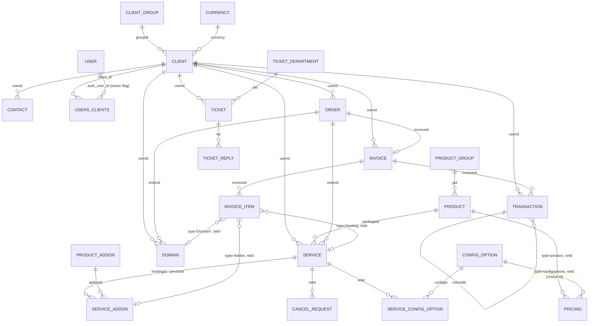

# WHMCS schema: what public sources tell us (2026-10-31)

Question: can the WHMCS database schema (tables, columns, relations) be learned from public sources alone, in case
Mohar needs it for a database-export importer or to map API fields to underlying entities? Short answer: the
**relations and the polymorphic keys, yes; column types, constraints and tax internals, no.** Enough for the API
importer today and for a narrow database reader later. Not enough for a full schema.

Boundary kept: public pages and public repositories only. No WHMCS file was opened, decoded or run, no WHMCS install
was made, no leaked copy or schema dump was used. Table and column names below are facts; descriptions are in our
words. Nothing here is legal advice.

## 1. Sources

All read 2026-10-31, fetched one at a time with a delay. "Facts only" means that only table and column names and
relations were recorded from these sources; no text or code was copied.

| # | Source | What it gives | Licence or terms | Reliability | Link |
|---|---|---|---|---|---|
| S1 | WHMCS class reference (the old `classdocs.whmcs.com` redirects to `9.0/index.html`; the live copy is on the developer portal, versions 9.0 and 8.13). Markdown form of each page at `.md`; the page list is `llms.txt`. About 30 model classes: `Billing\Invoice`, `Invoice\Item`, `Payment\Transaction`, `Currency`, `Quote`, `User\Client`, `Client\Contact`, `Client\Group`, `Client\Affiliate`, `Service\Service`, `Service\Addon`, `Service\CancellationRequest`, `Domain\Domain`, `Product\Product`, `Product\Addon`, `Product\Group`, `CustomField`, `CustomFieldValue`, `Config\Setting` | **Relations with their kind** (belongsTo, hasMany, hasOne, belongsToMany) for the core entities; status constants; a few table names in prose (`tblclients`, `tblclientgroups`, `tbladdons`, `tblhosting`, `tblhostingaddons`, `tblconfiguration`). No columns, casts or types: property tables are empty or list only a few. No ticket, order, tax or credit model is documented | No open licence stated on the pages; the footer of the database-interaction page (S4) reads "© 2026 WHMCS. All rights reserved." Used for facts only | High for what it states (it is generated from the code); thin | https://developers.whmcs.com/classes/whmcs/billing/invoice.md (and siblings), index https://developers.whmcs.com/llms.txt |
| S2 | API reference, about 30 actions read: `GetClientsDetails`, `GetInvoice`, `GetClientsProducts`, `GetClientsAddons`, `GetClientsDomains`, `GetOrders`, `GetTransactions`, `GetTickets`, `GetTicket`, `GetContacts`, `GetUsers`, `GetCurrencies`, `GetProducts`, `GetCredits`, `GetCancelledPackages`, `GetPayMethods`, `GetQuotes` and more | **Field names** of each response, from the parameter tables and the example JSON. They mirror column names closely but are not guaranteed to be the columns. Gives every id link (`userid`, `orderid`, `serviceid`, `relid`, `packageid` as `pid`, `invoiceid`, `contactid`, `deptid`) and the example values (statuses, `type` strings) | As S1 (no open licence stated) | High for the API shape; medium as a column list | https://developers.whmcs.com/api-reference/getinvoice.md etc. |
| S3 | Hooks reference (invoices and quotes, service, ticket, client, domain, user) | Parameter names at event time (`relid`, `serviceid`, `userid`, `domainid`, `ticketid`, `replyId`, `originalinvoiceid`, `newinvoiceid`). Confirms that the cancellation-request `relid` is a service id | As S1 | High | https://developers.whmcs.com/hooks-reference/service.md etc. |
| S4 | Developer docs: database interaction, module parameters, payment gateway pages | Names the connection layer (Laravel-based; `Capsule`), `tblclients`, `tblhosting`, `tblproducts`, `tblservers` in prose. Says nothing about column types | Same | High, thin | https://developers.whmcs.com/advanced/db-interaction.md |
| S5 | WHMCS public GitHub organisation: sample addon, provisioning, registrar, gateway (merchant, third party, tokenised, remote input, remote bank) and notification modules | **Almost nothing** about the schema: one code comment in the gateway sample (`modules/gateways/gatewaymodule.php`, subscription cancellation) names `tblhosting.subscriptionid`; the addon sample creates its own `mod_` table with the schema builder. Value is the module parameter names, not tables | MIT (all sample modules) | High, very thin | https://github.com/WHMCS (repos `sample-*`) |
| S6 | WHMCS theme repos (`templates-six`, `templates-twenty-one`, `templates-nexus`, order forms) and `developer-docs` repo | Template variable names that mirror fields. **Not mined**: no licence is declared (so all rights reserved) and the API reference already gives the same names | None declared | n/a | https://github.com/WHMCS/templates-nexus etc. |
| S7 | **Paymenter's built-in WHMCS importer** (`app/Console/Commands/ImportFromWhmcs.php`). It reads a restored WHMCS dump in a temporary database over SQL | The best single source for **table names, column names and joins**: `tblclients`, `tblusers`, `tblusers_clients`, `tbladmins`, `tblcurrencies`, `tblproductgroups`, `tblproducts`, `tblpricing`, `tblproductconfig*`, `tblproduct_upgrade_products`, `tblhosting`, `tblorders`, `tblcancelrequests`, `tblinvoices`, `tblinvoiceitems`, `tblaccounts`, `tbltickets`, `tblticketreplies`, `tblticketdepartments`, with the columns it reads and its status and cycle value maps. About 1,000 lines | MIT (checked with the GitHub API, 2026-10-31; last push 2026-10-30) | Medium to high: it works against real databases, but it was written for the version its author tested | https://github.com/Paymenter/Paymenter/blob/master/app/Console/Commands/ImportFromWhmcs.php ; guide https://paymenter.org/docs/guides/whmcs-importer |
| S8 | Nuvabill's WHMCS importer (`app/Import/Whmcs/WhmcsImporter.php`) and `docs/whmcs-migration.md` | Confirms S7 and adds `tbldomains`, `tbldomainpricing`, `tblhostingaddons`, `tblhostingconfigoptions` (`relid`, `configid`, `optionid`, `qty`), `tblproductconfiglinks` (`gid`, `pid`), `tblproductconfigoptionssub` (`configid`), `tblcustomfields`, `tblcustomfieldsvalues`, `tblservers`, `tblconfiguration`; the `tblpricing` `type`/`relid` pairs; the owner join through `tblusers_clients.owner = 1`; password-hash eras (as it states them) | AGPL-3.0. **Facts only**: names and joins were taken and nothing else; its `WhmcsCrypt.php` was not opened | Medium: it is a third-party claim, but it checks table presence at run time, which shows version drift | https://github.com/meroxis/nuvabill (`docs/whmcs-migration.md`) |
| S9 | Upmind's "Importing from WHMCS" guide | Confirms an API-based import is the norm for hosted tools; names `tblapiroles` once (API role rows). No other tables | No licence stated (hosted docs) | Medium | https://docs.upmind.com/setup-and-configuration/importing-data/importing-from-whmcs.md |
| S10 | Blesta Import Manager docs (WHMCS 5.2 to 8.x; CLI, needs the install's encryption hash) | Process only: reads the WHMCS database directly, asks for the card-encryption hash. No table mapping is published; the plugin is not open | Vendor docs | Medium (process only) | https://docs.blesta.com/display/user/Import+Manager |
| S11 | WHMCS-Oblio (invoice sync addon, GPL-3.0) | Names `tblclients`, `tblinvoices`, `tblaccounts`, `tblcustomfields`, `tblconfiguration` as queried by a third-party addon. Confirms S7/S8 only | GPL-3.0; names only | Low value, consistent | https://github.com/CrockyHost/WHMCS-Oblio |
| S12 | System requirements and troubleshooting pages (mirror), not studied | Strict SQL mode is unsupported; `utf8_unicode_ci` recommended; mixed collations seen in the wild | Vendor docs | Medium | https://whmcsdocs.devops.cpanel.net/8-13/installation-guide/system-requirements |

**Not used, provenance unclear or no licence:** `lukapaunovic/boxbilling-to-whmcs-migration` (writes into WHMCS; no
licence), `LithiumHosting/libilling-importer-whmcs` (no licence declared; not opened), `Megabre/whmcs-custom-import`
(no licence), `prabhusoft-pvt-ltd/whcms-migration-research` (no licence), and any "WHMCS database schema" dump or SQL
file found on forums, gists or file sites: none was opened. **Not sampled:** whmcs.community threads (they quote
queries, but the posts' terms vary and S7/S8 already cover the ground), HostBill's import page, `docs.whmcs.com` data
retention page (the URL tried returned 404). FOSSBilling has no WHMCS importer: its tracker only has a CSV import
request (https://github.com/FOSSBilling/FOSSBilling/issues/59) and its forum says no import exists.

## 2. Reconstructed entities and relations

Confidence marks: **C** confirmed by at least one allowed source that states the relation or the join (source
numbers in brackets); **I** inferred from field names (a `*id` field in an API response) or from naming, not stated.
Table names carry the same marks. WHMCS identifies rows by integer `id`; there is no UUID except a client `uuid`
field in `GetClientsDetails` (S2).

Edges are drawn without confidence marks; confirmed and inferred relations are marked in the table in 2.1.

### 2.1 Relation table

| Entity (table) | Relation | Kind | Mark | Source |
|---|---|---|---|---|
| Client (`tblclients`) | has many invoices, services, domains, transactions, orders, quotes, contacts, credit notes, debit notes, custom-field values | hasMany | C | S1 |
| Client | belongs to a group (`tblclientgroups`, field `groupid`) | belongsTo | C (relation); I (column `groupid`, from S2 and hooks) | S1, S2 |
| Client | belongs to a currency (`tblclients.currency` is the currency id) | belongsTo | C | S1 (`currencyrel`), S7 (reads `currency` from `tblclients`) |
| Client | has one billing contact (`billingcid`; 0 means the client's own details) | hasOne | C | S1, S2 |
| Client | has one affiliate record | hasOne | C | S1 |
| Contact (`tblcontacts`, **table name I**) | belongs to a client (`userid`) | belongsTo | C (relation); I (name) | S1, S2 |
| User (`tblusers`) and `tblusers_clients` | A login (user) is linked to clients through a pivot with `auth_user_id`, `client_id` and `owner`. Claim 2 (separate): the importers read the password hash from `tblusers` through the owner row (`owner = 1`); S8's guide says hashes are bcrypt from WHMCS 7 (unverified here) | many-to-many | C | S7, S8; S2 (`users[].is_owner`, `owner_user_id`) |
| Product group (`tblproductgroups`) to product (`tblproducts`) | `gid` | hasMany | C | S1, S7 |
| Product to service (`tblhosting.packageid`) | | hasMany | C | S1, S7 |
| Service (`tblhosting`) | belongs to client (`userid`), product (`packageid`), order (`orderid`), server (`server`) | belongsTo | C (client, product, order); I (server column name) | S1, S7, S2 (`serverid`) |
| Service | has many addons (`tblhostingaddons`), cancellation requests, SSL orders, custom-field values, config options | hasMany | C | S1, S8 |
| Service addon (`tblhostingaddons`) | belongs to a service, a catalogue addon (`tbladdons`, via `addonid`) and a client | belongsTo | C (relation); I (column `hostingid`; the API calls it `serviceid`) | S1, S2 |
| Service config option (`tblhostingconfigoptions`) | `relid` is the service id; `configid` points at a configurable option; `optionid` at the chosen sub-option; `qty` for quantity types | belongsTo | C | S8 |
| Config option structure | `tblproductconfiggroups` -> `tblproductconfigoptions` (`gid`) -> `tblproductconfigoptionssub` (`configid`); groups link to products through `tblproductconfiglinks` (`gid`, `pid`) | hasMany | C | S7, S8 |
| Pricing (`tblpricing`) | One shared price table with `type` and `relid`: `product`, `configoptions` (relid is a sub-option id), `domainregister`, `domaintransfer`, `domainrenew`; one row per currency, with a price column and a setup-fee column per billing cycle (a code comment in S8; the monthly/quarterly/... keys of `GetProducts` pricing in S2 look the same) | polymorphic | C | S7, S8 |
| Product upgrades (`tblproduct_upgrade_products`) | `product_id` to allowed upgrade products | many-to-many | C | S7, S1 (`upgradeProducts`) |
| Domain (`tbldomains`) | belongs to client and order; has many additional fields and extras | belongsTo / hasMany | C | S1, S8 (table), S2 |
| Order (`tblorders`) | belongs to client (`userid`); links its invoice by `invoiceid`; owns services, addons and domains by `orderid` | belongsTo | C (table, client, services, domains); I (that an order has one invoice via `invoiceid`, from S2 `GetOrders`) | S7, S1, S2 |
| Invoice (`tblinvoices`) | belongs to client; has many items, transactions; has one snapshot; belongs to one order; has pay method | hasMany / belongsTo | C | S1, S7 |
| Invoice and its services/addons/domains | many-to-many through items (`servicesProduct`, `servicesAddon`, `servicesDomain`) | belongsToMany | C | S1 |
| Invoice item (`tblinvoiceitems`) | `invoiceid`; `type` + `relid` polymorphic (see section 4); `description`, `amount`, `taxed` | belongsTo | C (`invoiceid`, `type`, `relid`, `description`, `amount`); C (`taxed`, S2 example) | S7, S2 |
| Transaction (`tblaccounts`) | belongs to client and invoice (invoice 0 for a payment taken as account credit); `refundid` to the original transaction; `currency` is a currency id (0 in S2's sample); `amountin`, `amountout`, `fees`, `rate`, `transid`, `gateway`, `date` | belongsTo | C (class relations, `invoiceid`, `amountin`, `transid`, `date`, `userid`); I (rest from S2 field names) | S1, S2, S7 |
| Cancellation request (`tblcancelrequests`) | `relid` is the service id; `reason`; `type` text (the end-of-period value is `End of Billing Period`); `date` | belongsTo | C | S7, S3 |
| Ticket (`tbltickets`) | `userid` (client), `did` (department), `title`, `urgency`, `status`, `date`, `lastreply`; API adds `tid` (public ticket number), `c` (access key), `contactid`, `flag` (assigned admin), `service` | belongsTo | C (`userid`, `did`, `title`, `urgency`, `status`, `date`, `lastreply`); I (rest from S2) | S7, S2 |
| Ticket reply (`tblticketreplies`) | `tid` is the ticket id; `userid`, `message`, `date`; API adds `contactid`, `admin` (admin name) and `rating` | belongsTo | C (`tid`, `userid`, `message`, `date`); I (rest) | S7, S2 |
| Ticket department (`tblticketdepartments`) | `id`, `name` | | C | S7 |
| Credit (`tblcredit`, **table name I**) | per client, `relid` meaning unknown (0 in S2 sample) | | I | S2 |
| Tax | An invoice stores `taxrate`, `taxrate2` and totals `tax`, `tax2` (two levels). Rules live in a tax-rules table whose name and columns are **not** confirmed; the class docs say that where several rules match, only the lowest-numbered rule applies | | C (invoice fields); gap (rules) | S2, S1 |
| Quote (`tblquotes`, `tblquoteitems`) | belongs to client (`userid`); items have `quantity`, `unitprice`, `discount`, `taxable` | | C (class relations); I (table names) | S1, S2 |
| Settings (`tblconfiguration`) | key/value store | | C | S1, S8 |

### 2.2 Value sets seen in the sources

Statuses and cycle strings are text, not integers, so a mapper needs lookup tables.

- Invoice status: Draft, Unpaid, Paid, Cancelled, Refunded, Collections, Payment Pending (S1 constants; S7 maps only Paid, Unpaid, Cancelled, Refunded).
- Service status (`domainstatus`): Active, Suspended, Terminated, Cancelled, Fraud, Pending (S7).
- Billing cycle: Monthly, Quarterly, Semi-Annually, Annually, Biennially, Triennially, One Time, Free Account (S7). The API's `GetProducts` pricing uses names without hyphens (`semiannually`) and `-1.00` for a disabled cycle (S2, migration.md).
- Dates: zero dates (`0000-00-00`) stand for "not set" (S2 example).

## 3. Gaps: what public sources do not give

- **Column types, lengths, nullability, defaults, indexes, foreign-key constraints, charset and collation per column.** None is published. Class property tables are empty, and the API returns strings for numbers.
- **Complete column lists.** We know the columns that two importers and the API happen to read. Fields they ignore (for example promo links on a service, `tblhosting` override flags, SSL and fraud fields) are unknown beyond API names.
- **Tax.** The tax rules table, its levels, compound flag, country and state matching, and how client tax-exempt flags apply are not documented. Only the invoice-side numbers are visible.
- **Credit, promotions, affiliates, billable items, upgrades (`tblupgrades`), projects, quotes internals, `tblinvoicedata`/snapshots, `tbltransaction_history`, `tblpaymethods`.** Relations exist in the class docs or API but no column-level source.
- **Encrypted fields** (card data, server and service passwords). They use the install's secret hash. We have no wish to read them; the standing refusal in migration.md applies.
- **Version drift.** WHMCS 8 added users and `tblusers_clients`, 8.12 added `qty` to `GetClientsProducts` and `GetClientsAddons` (their version-history tables, S2), 9.0.5 strengthened stored-data encryption (our refresh note); the sources do not give per-version DDL. S8 checks for table presence at run time, which tells us drift is real.
- **Semantics of `relid` for types other than `Hosting` and `Addon`** (see section 4).
- **Anything that only a running install shows.** We do not have one and must not install WHMCS. The repository's own state file lists the lack of a WHMCS dev licence or fake-data export as an open blocker for fixtures.

## 4. The polymorphic `relid` (and friends), for the importer

The same column name means different things depending on a sibling `type` column. These are the ones public sources show:

| Where | `type` values seen | `relid` points at | Mark | Source |
|---|---|---|---|---|
| Invoice item (`tblinvoiceitems`; API `GetInvoice.items.item[]`) | `Hosting` | `tblhosting.id` (service) | C | S1 (Invoice docs), S2 |
| | `Addon` | `tblhostingaddons.id` | C | S1 |
| | `Domain`, and likely the register/transfer/renew variants | `tbldomains.id` | I (S7 shows `Domain` and `Upgrade` as types it does not link; the domain target is inferred) | S7 |
| | `Upgrade` | an upgrade row (`tblupgrades`) | I | S7 |
| | empty type, `relid` 0 | none: manual line, late fee, credit line, billable item | I | S2 |
| Pricing (`tblpricing`) | `product`, `configoptions`, `domainregister`, `domaintransfer`, `domainrenew` (also addon, likely) | product id, config sub-option id, or domain pricing row id | C (listed ones) | S7, S8 |
| Order line (`GetOrders.lineitems`) | lower-case `product`, with `relid` and `producttype` | service id (inferred) | I | S2 |
| Cancellation request | `type` is a free-text reason kind, `relid` is the service id | `tblhosting.id` | C | S7, S3 |
| Custom-field value (`tblcustomfieldsvalues`) | field's own type (client, product, addon...) decides if `relid` is a client, service or addon id | varies | C (that it varies, S1 has client/service/addon relations); I (columns) | S1, S8 |
| Credit (`GetCredits.relid`) | none shown | 0 in the sample | I | S2 |

Case differs: invoice item types are capitalised words (`Hosting`), order line types are lower case (`product`).

## 5. How this helps the API importer today

The importer (migration.md) reads only the API. The picture above gives it a few rules with no extra source needed:

1. **Keep every source integer id in the id map**, keyed by entity: client (`userid`/`clientid`), user, contact, order (`orderid`), service (`serviceid`, which is `id` in `GetClientsProducts`), addon row (`id`) and catalogue addon (`addonid`), domain (`domainid`), invoice (`invoiceid`), transaction (`id`), ticket (`ticketid`) and department (`deptid`), currency (`id`). Never reuse a number across entities: a service id and an addon row id collide.
2. **Resolve an invoice item by `type` first.** `Hosting` goes to the service map, `Addon` to the addon-row map, domain types to the domain map. Anything else (empty, `Upgrade`, unknown) imports as a plain line with no link, with an issue noted. `relid = 0` means "no link".
3. **Keep `invoiceid` and `invoicenum` apart.** WHMCS's own docs say the id is internal and the sequential number is customer-facing and may be used for VAT purposes. Import the number as given (empty means none); never rebuild it from the id.
4. **Invoice totals are stored, not recomputed:** `subtotal`, `credit`, `tax`, `tax2`, `total`, `balance`, `taxrate`, `taxrate2`. Import them and flag a mismatch rather than recalculating (this is the Nepal VAT record).
5. **A transaction has an invoice id of 0** when it is not against an invoice, and `refundid` points at the original. `GetInvoice.transactions` can be an empty string instead of a list.
6. **Ticket replies: the opening message arrives as the first reply** (`replyid` 0 in the example), `contactid` 0 means the client themselves, and replies carry `userid` of the client even for staff replies, with the staff name in `admin`. Do not treat `userid` on a reply as the author.
7. **Cancellation requests** (`GetCancelledPackages`) use `relid` as the service id; map them to the service, not to a client.
8. **Currencies are ids on clients, transactions (`0` in the sample) and invoices implicitly**; resolve through `GetCurrencies`. `0` needs a rule (default currency).
9. **Status and cycle text values need explicit maps** (section 2.2), and the importer should say "unknown value" instead of defaulting, which is what S7 does (it maps unknown service statuses to pending and unknown cycles to monthly, silently).
10. **IDs in API examples disagree with each other** (`domains[domain][0][id]` flattened keys, numbers as strings). The normaliser in migration.md already handles that; it belongs in fixtures.

## 6. Recommendation

1. **Keep the 2026-10-17 decision (`requirements.md`; `client-import.md` A6 and §3.3; `migration.md` §2.2): API first, no database connector in v1.** ADR 0019 only covers pipeline extension points and does not take this decision. Nothing here changes the
   reasons that matter: the API is the supported contract, versions drift, and the standing refusal to request
   encryption hashes stands.
2. **Correct one premise.** migration.md §2.2(a) says table and column knowledge "would come from outside the public
   API docs". It does come from outside the docs, but it is publicly available under open terms: a maintained MIT
   importer (S7) and an AGPL one (S8). The clean-room position is weaker on style (we should not follow their code)
   and unaffected on facts (names and joins). Suggested wording for the next edit to migration.md: "knowledge is
   available from public importers, but not verifiable without an install".
3. **If a database reader is ever built, keep it to the "gap reader" of client-import.md §3.3**, which reads only
   login password hashes, a 2FA-enabled flag, custom-field names and the user verification state, and nothing else.
   Separately, this note raises a **question to widen §3.3** (owner Q1b below): the API also lacks product groups,
   the addon catalogue and configurable-option structure (migration.md §2.1 lists these gaps, now covered by operator
   mappings). Reading them from a dump would need the owner to widen §3.3; nothing here assumes it. Shape for either
   scope: the host exports **their own** database (a standard dump), restores it into a throwaway database on a
   machine they control, and gives Mohar read-only access to that copy, as Paymenter's flow does (Blesta's and
   HostBill's connect to the live database and ask for the encryption hash, per client-import.md §3.3, which we
   refuse). Never connect to the live database, never ask for the encryption hash, never read card or server
   password columns.
4. **What it would need first:** a fixture source (a host's anonymised export, since we have no WHMCS licence and will
   not install WHMCS), a per-column "provenance map" (table, column, source number from section 1) so a reviewer can
   check each field against an allowed source, a presence check for every table and column (as S8 does, so drift
   becomes a report line rather than a crash), and a version probe. Do not implement before the owner answers the
   questions below.
5. **Do now at no cost:** keep the API connector's fixtures keyed to the field names above; add the ids and the
   polymorphic `relid` rules (section 5) to the migration spec as acceptance criteria if not already there.

### Owner questions (not legal advice)

1. Does the owner want a database "gap reader" at all, or does the API-only decision stand? What is the cost of losing
   password hashes (clients must reset)? This is client-import.md Q1; this note adds that the schema knowledge is
   mostly available.
   1b. If yes, stay with the §3.3 list, or widen it to product groups, the addon catalogue and configurable-option
   structure (and `tblhostingaddons` rows, which `GetClientsAddons` returns only per client)?
2. A host importing from **their own** WHMCS install: is the host entitled, under their WHMCS licence terms, to hand
   an export of their own data to a third-party tool? We have not read the WHMCS licence or terms of service for this;
   someone with a legal view should, before the feature is offered. The same question applies to Mohar staff doing a
   migration for a host.
3. Is it acceptable that knowledge of table and column names came partly from other open-source importers (MIT and AGPL)?
   Names and joins were recorded as facts; no code or wording was taken, and the AGPL source was used for names only.
   The owner may prefer to decide that policy once.
4. Fixtures: may we ask a friendly host for an anonymised export, or should we stay with hand-made fixtures built
   from the API examples?
5. The WHMCS developer portal footer says "All rights reserved" and the theme repos declare no licence. Only facts were
   recorded; the owner should confirm that is the line to hold.

## 7. Source log

Fetched 2026-10-31: developers.whmcs.com (`llms.txt`; class pages `billing/invoice`, `billing/invoice/item`,
`user/client`, `user/client/contact`, `user/client/group`, `user/client/affiliate`, `service/service`,
`service/addon`, `service/cancellationrequest`, `domain/domain`, `domain/extra`, `domain/additionalfield`,
`product/product`, `product/addon`, `product/group`, `product/pricing/price`, `billing/payment/transaction`,
`billing/currency`, `billing/quote/item`, `billing/vat/vatnumber`, `customfield`, `customfield/customfieldvalue`,
`config/setting`; API reference pages named in S2; hooks pages named in S3; `advanced/db-interaction`;
`provisioning-modules/module-parameters`; `payment-gateways/transaction-information`; `advanced/date-functions`).
`billing/quote` returned no content. GitHub: WHMCS org repo list and licences, shallow clones of the sample modules,
Paymenter importer file, Nuvabill importer file and migration guide, WHMCS-Oblio helper (names only). Web:
paymenter.org guide, docs.upmind.com import guide, search results for Blesta, FOSSBilling, HostBill and WHMCS
requirements pages. Scratch files were kept outside the repository.
