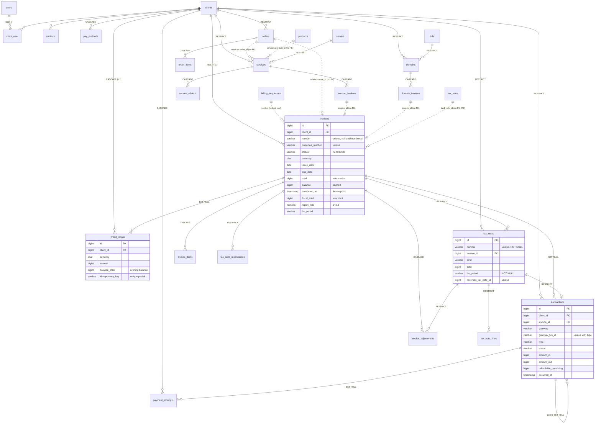

# Database architecture review — 2026-10-31

- Reviewer: database reviewer (principal-level, whole database). First whole-database review; until now the schema
  was reviewed only inside PR reviews.
- Scope: `develop` at `e69e245e` (#536 merged): 113 migrations, 128 tables, 177 foreign keys, 533 indexes, 1,668
  columns. Read against `architecture.md`, ADRs 0001, 0002, 0006, 0013, 0017, 0019, 0020, 0021, 0022, 0024, 0025,
  0028 and 0029, the 10-19 to 10-29 architecture reviews and `docs/devops/sizing.md`.
- Method: the schema was migrated onto PostgreSQL 18.6 and dumped (`pg_dump --schema-only`, `pg_constraint`,
  `pg_indexes`, `information_schema.columns`); models, actions, controllers and automation tasks were read for the
  queries behind each hot path; the load-test seed (`loadtest/seed`, `small`) was loaded and multiplied by SQL to
  286,720 invoices, 286,768 lines, 271,888 transactions, 300,089 activity entries, 201,021 email log rows and 40,001
  queued jobs (633 MB), then `EXPLAIN (ANALYZE, BUFFERS)` was run on 24 hand-written hot-path statements and on the
  same statements with the proposed indexes created in a rolled-back transaction. Three findings are pinned by red
  Pest probes on `review/db-arch-2026-10-31-probes`
  (`billing/tests/Feature/Billing/DatabaseArchitectureProbesTest.php`, commit `9bfff1c5`): on SQLite 2 failed and 1
  skipped, on PostgreSQL all 3 failed, as intended. Paths are relative to `billing/`.
- PostgreSQL run: yes (schema dump, seed, every EXPLAIN and the probes).

## Verdict

**Changes requested.** Nothing blocks the next release: the money paths are transactional and row-locked in a
documented order, idempotency is backed by unique indexes everywhere it matters, fiscal documents snapshot their
values and numbers come from a locked gap-free sequence. The schema is in better shape than most billing systems
at this age. What a principal engineer would not sign off yet, in order:

1. the database does not enforce what the ADRs promise: a client's money ledger cascades away with the client row
   (H1), a numbered tax document can be changed by any statement that is not an Eloquent save (H2), and the tax
   rule an invoice was classified with can be deleted from under it (M3);
2. four hot paths are served by walking the wrong index, which is why the admin dashboard is the load test's
   outlier and why the billing-day tasks get slower with every month of history (H3, H4); the fix is five indexes
   measured here at 6 to 800 times faster;
3. three tables grow for ever with no retention (H5), one of them carrying the slowest statement of the billing day;
4. cross-module references have no referential integrity at all (M4), and the production database runs on image
   defaults as the superuser (M7).

The fix plan at the end is six small PRs; the first three are migrations only.

## Entity map

Core money, client and service tables as they exist on `develop`. Solid lines are foreign keys; dotted lines are
links by id with no foreign key (M4).

Ownership is clear for every table: each lives under one module's `Database/Migrations` and is written by that
module (`settings` rows are written by several modules through Core's `Settings`, which is the designed exception).
Reports read other modules' tables by ADR 0001 rule 3. No module writes another module's table directly; the
cross-module links above are ids carried through contracts, which is why they have no foreign keys.

## Findings

Severity: **High** means money, fiscal or availability at the measured scale; **Medium** means a correctness gap
with a known workaround or a cost that grows with data; **Low** is hygiene. Each gives the file, the failure
scenario, the evidence and the fix. No Blocking findings.

### High

**H1. A client's credit ledger is deleted with the client row.**
`app/Modules/Billing/Database/Migrations/2026_10_17_300001_create_billing_tables.php` (credit_ledger:
`cascadeOnDelete()`); the same for `payment_attempts`, `payment_batches` and `pay_methods`, while `transactions`
and `invoices` are `RESTRICT`.
Scenario: a client who only ever received manual credit (no invoice, no payment) is deleted by a support script,
a future "delete client" action or a `DELETE` in `psql`; the delete succeeds and every `credit_ledger` row
(amount, balance, reason, who) is gone, with no activity entry, because the activity entry is written by the
action, not by the database. Today no code path deletes a client (`Platform/Actions/Clients/CloseClient.php`
closes; `MergeClients` closes the source), so the cascade is dormant, which is exactly when it bites: the first
delete path added later inherits it.
Evidence: probe 1 is red on both databases (`DELETE FROM clients` succeeds; the ledger row count goes from 1 to 0).
Fix: `restrictOnDelete()` on `credit_ledger.client_id`, `payment_attempts.client_id` and `payment_batches.client_id`
(`pay_methods` can stay cascade: a token is not history). Drop and re-add the three constraints under
`LockTimeout::run` with the action named, `@compatible` because no row violates it.

**H2. Fiscal immutability is enforced only by Eloquent.**
`app/Modules/Billing/Models/Invoice.php:177-199` and `TaxNote.php:135-143` refuse changes in `updating`/`deleting`
hooks. ADR 0024 §9 deferred a trigger ("needs its own ADR").
Scenario: `DB::table('invoices')->where('id', $id)->update(['total' => …])`, a `psql` session, a backfill command
with a bug, or a future importer path changes `total`, `number`, `issue_date` or `fiscal_*` on a numbered invoice
and the VAT register silently reports a different value from the PDF the client holds. The 12 query-builder writers
on `invoices` today (`FiscalBackfill`, `FiscalVatSplit`, `NepalVatMode`, `ConfigureGateway`, `NoteRefusals`) all
restrict themselves to allowed columns, so no bug exists on develop; the guarantee the ADR promises ("a numbered
document is immutable") is one `->update()` away from not holding.
Evidence: probe 2 (PostgreSQL only) is red: the update succeeds and `total` changes.
Fix: a short ADR amendment and one migration adding a PostgreSQL trigger (`BEFORE UPDATE OR DELETE ON invoices
FOR EACH ROW WHEN (OLD.numbered_at IS NOT NULL)`) that raises unless only the columns outside `FROZEN_WITH_NUMBER`
and `FROZEN` changed, and `BEFORE UPDATE OR DELETE ON tax_notes` allowing only `print_count`, `cbms_*` and
`updated_at`. The migration is a no-op on SQLite (`DB::getDriverName()`), and the test is PostgreSQL-only, which
is how `SearchIndexesTest` already works. Proforma numbering is unaffected: the trigger fires on `numbered_at IS
NOT NULL`, and the transition that sets it is an update whose OLD row has it NULL.

**H3. The admin dashboard's receivables query reads the heap of every open invoice and walks the wrong index for
cancellations.**
`app/Modules/Billing/Support/BillingDashboard.php:683-690` (three-branch `UNION ALL` under `fromSub`).
Scenario: the sizing doc measured the income, receivables and MRR aggregates at 493, 486 and 397 ms at 359k
invoices and the dashboard at p95 3.1 s under load; the widget is cached 30 s, so every cache miss during a busy
morning stalls one staff request for the full scan. The cost grows with open invoices (heap reads) and with
cancelled invoices (the third branch).
Evidence: Q7 below, 99.9 ms at 287k invoices: the open branch reads 3,249 heap blocks for 11,240 rows of 16 bytes;
the cancelled branch is an `Index Scan using invoices_status_due_date_index` on `status = 'cancelled'` with
`cancelled_at` as a filter, 3,809 rows removed, 27.8 ms. With a covering partial index on open invoices and a
partial index on `cancelled_at`, the same statement runs in 16.2 ms (P7).
Fix: `OnlineIndex` for `invoices (status) INCLUDE (currency, balance, issue_date, due_date) WHERE status IN
('unpaid','payment_pending','collections')` and `invoices (cancelled_at) WHERE status = 'cancelled'`. The
structural fix, when the dashboard still misses the 200 ms target, is a daily `receivables_snapshots` row per
currency written by the housekeeping stage (ADR 0020 §4 puts caching in the registry; a snapshot table is the
database form of that).

**H4. The billing-day tasks walk the primary key and filter, so each run costs the whole table.**
`app/Modules/Billing/Services/BillingAutomation.php:55-61, 84-89, 140-144, 155-160, 227-232` (late fees,
auto-capture, reminders, auto-cancel: `where status = unpaid … ->chunkById(200)`), and the same shape in
`Services/Actions/SuspendOverdueServices.php:39-42` and `GenerateRenewals.php:49-57`.
Scenario: `chunkById` adds `AND id > ? ORDER BY id LIMIT 200`, and the planner prefers walking `invoices_pkey` to
the `(status, due_date)` index because the sort is free that way. Open invoices are a shrinking share of a growing
table (33k of 35k seeded invoices are paid), so every chunk discards more rows: at 287k invoices each 200-row
chunk discards 26,903 rows and takes 17.7 ms; at 2M invoices with the same 11k open it discards about 190k rows
per chunk. The review rules ask that "scheduled queries name their index and cap work per run"; these name none
and have no cap.
Evidence: Q11 (17.66 ms, `Rows Removed by Filter: 26903`, 3,682 buffers) against P11 with a partial index
(`invoices (id) WHERE status IN (payable)`): 2.5 ms, 19 rows removed. `GenerateRenewals` (Q9) shows the same
`Index Scan using services_pkey` + filter, cheap today because 25% of services are due on the measured day.
Fix: one partial index `invoices_open_id_index ON invoices (id) WHERE status IN ('unpaid','payment_pending',
'collections')` (the four tasks and `scopeOutstanding` all filter on this set), and
`services (id) WHERE status IN ('active','suspended') AND deleted_at IS NULL` for the three service tasks. Add a
per-run cap (`--max`, as `billing:fiscal-snapshot` has) so a backlog after an outage drains over several runs
rather than one 540 s transaction-heavy run.

**H5. Three tables grow for ever, and the largest write of the billing day is the one with fifteen indexes.**
`app/Modules/Platform/PlatformServiceProvider.php:177-184` (activity log: `whereNull('client_id')`, so entries
tied to a client are kept "until the client is deleted", which never happens, see M11);
`app/Modules/Services/Models/ModuleCommand.php` (`module_commands`, request and response JSON per provisioning
call, no prune task at all); `app/Modules/Notifications/Actions/PruneNotificationLogs.php` (bodies are purged,
rows are never deleted); `Notifications/Database/Migrations/2026_10_18_800100` and `800300` (15 indexes on
`email_messages`, including `status` beside `(status, updated_at)` and `created_at` beside
`(body_purged_at, created_at)`).
Scenario: a 5,000-client host writes roughly 2 to 5 activity rows per invoice event and one email row per
notification; after three years `activity_log` and `email_messages` are the two largest tables, their indexes are
larger than the money tables, every `INSERT` into `email_messages` maintains 15 indexes (the sizing doc already
names this insert as the slowest automation statement: 14,289 calls, 7.2 s), and the two admin pages on them are
the ones that regress first (Q13b, Q13c, Q17 count).
Evidence: at 300k activity rows the free-text search (`Like::where` on `description`, not covered by
`SearchIndexesTest`) is a `Parallel Seq Scan`, 45.7 ms; the `DISTINCT event` list that the page loads on every
request is a full index-only scan, 21.1 ms; the `count(*)` of the email log is 17.7 ms. All three are linear in
table size.
Fix: (a) `services.command_log_prune` task for `module_commands` with a setting (90 days default, like
`domains.command_log_prune`); (b) email log metadata retention (settings default 730 days) and a review of its
indexes: drop `email_messages_status_index`, `email_messages_created_at_index` and `email_messages_recipient_index`
(the latter only if the admin log never filters by recipient alone) — three fewer index writes per message;
(c) activity log: either a trigram index on `lower(description)` (P13b: 0.06 ms) added to `SearchIndexesTest`, or
drop the free-text box in favour of the event, client and user filters that are indexed; replace the `DISTINCT
event` list with the keys `ActivityLogger` already knows; and give the prune a partial index
`(created_at) WHERE client_id IS NULL` (Q13d today BitmapAnds two indexes). Partitioning by month is the later
step for both logs; nothing in the schema prevents it.

### Medium

**M1. Client invoice list and dashboard sort every invoice of the client.**
`Billing/Http/Controllers/Client/InvoiceController.php:64-66` and `Support/BillingClientDashboard.php:128-130`
order by `issue_date DESC, id DESC` with only `(client_id, status)` to serve them.
Scenario: a reseller with 1,600 invoices opens the client area; the list reads 1,222 heap blocks and top-N sorts.
Evidence: Q4 16.0 ms, Q21 5.1 ms; with `(client_id, issue_date DESC, id DESC)` (P4) 0.12 ms.
Fix: that index through `OnlineIndex`. It also serves ADR 0029's cursor pagination for `/api/v1/account/invoices`.

**M2. `paginate()` counts the whole table on the unfiltered admin lists.**
`Billing/Http/Controllers/Admin/InvoiceController.php:64`, `Notifications/.../EmailLogController` (email log),
`Core/.../ClientController.php:43`. The activity log already uses `simplePaginate` for this reason (#49).
Evidence: Q1b 19.5 ms and the email log count 17.7 ms at 287k and 201k rows, on every page view.
Fix: `simplePaginate` where the total is not shown, or a cached count per filter set.

**M3. The tax rule an invoice was calculated with can be deleted.**
`Billing/Database/Migrations/2026_10_27_300730_add_nepal_vat_classification_to_invoices.php` adds `tax1_rule_id`
and `tax2_rule_id` without a foreign key; `TaxRuleController::destroy` refuses only the rules Nepal VAT mode has
chosen. ADR 0024 Amendment (#432) makes the id the primary classification input, with name-and-rate matching
only "where an id is NULL".
Scenario: staff delete a retired rule that 2,000 numbered invoices still point to; `billing:fiscal-vat-split` later
classifies them by name and rate, and a renamed rule classifies them wrong.
Evidence: probe 3 is red on both databases.
Fix: `foreignId('tax1_rule_id')->constrained('tax_rules')->restrictOnDelete()` (same for level 2), and the
controller message "used by N invoices".

**M4. Cross-module links have no referential integrity, and the rule is unwritten.**
`orders.invoice_id`, `services.order_id`, `services.product_id`, `service_invoices.invoice_id`,
`domain_invoices.invoice_id`, `domains.order_id`, `domains.linked_service_id`, `domains.provision_invoice_id`,
`support_tickets.service_id`, `support_tickets.domain_id`, `order_items.product_id`, `services.promotion_id`,
`domains.promotion_id`, `module_queue.subject_*`, `email_messages.related_*`, `activity_log.subject_*`.
Scenario: a draft invoice is deleted (`InvoiceController::destroy`, allowed) while an `orders.invoice_id` or a
`service_invoices` row points at it; the order page then 404s on its invoice link and `hasInvoiceForPeriod` keeps
working only because it joins through `invoice_items`. ADR 0001 forbids class imports, not foreign keys; the
database can enforce a link the contract already exposes.
Fix: one sentence in `architecture.md` ("a module may declare a foreign key to a table it already reaches through
a contract; the action is `nullOnDelete` for optional links and `restrictOnDelete` for ownership"), then
`service_invoices.invoice_id`, `domain_invoices.invoice_id` and `orders.invoice_id` → `invoices` (RESTRICT: a
draft referenced by an order or a renewal record must be cancelled, not deleted), `services.product_id` →
`products` (RESTRICT; products soft-delete anyway). The polymorphic log links stay as they are.

**M5. Two CHECK constraints in 128 tables.**
Only `clients.email_source` and `clients.origin` are checked. Every status column is a free `varchar`, every money
column accepts any sign, `invoice_items.quantity` accepts 0, `tax_rules.rate` accepts 150.
Scenario: a backfill writes `status = 'Paid'` (TitleCase) and the invoice disappears from every list; a sign error
in a refund path stores a negative `amount_paid`.
Fix (cheap, in the same migration PR as H1): `CHECK (quantity > 0)` on `invoice_items`, `CHECK (rate >= 0 AND
rate <= 100)` on `tax_rules`, `CHECK (total >= 0 AND amount_paid >= 0 AND credit_applied >= 0)` on `invoices`,
`CHECK (amount_in >= 0 AND amount_out >= 0 AND fee >= 0)` on `transactions`, and status checks on `invoices`,
`transactions`, `services` and `domains` whose enums are stable (add a value = a tiny migration, which is also the
documentation). Add them `NOT VALID` then `VALIDATE` on PostgreSQL so the ALTER takes no long lock.

**M6. Every timestamp is `timestamp without time zone`, and two dashboards still convert zones in SQL.**
311 columns; ADR 0013 §1 says "storage is UTC and so do database sessions". That holds while `app.timezone` is
`UTC` and every writer is this application; `CoreCompanyClock::sqlLocalDate()` has to say
`(col at time zone 'UTC') at time zone ?` to re-state it (`CoreDashboard.php:143`, `BillingDashboard.php:655`),
which ADR 0013 Amendment 1 said would go once those dashboards bucket with `dayBounds()`.
Scenario: a reporting tool or a `psql` session with `timezone = 'Asia/Kathmandu'` writes a row and it is 5h45
off; nothing in the type says which it is.
Fix: not a migration now (changing the type is a contract-phase change on every table). Write the convention
down: new tables use `timestampTz()`; the two SQL zone conversions move to PHP bucketing as the amendment
planned; `postgres` in `compose.prod.yaml` gets `-c timezone=UTC` so an external session cannot differ.

**M7. Production PostgreSQL runs on image defaults as the superuser.**
`deploy/compose.prod.yaml:311-337`: the app's `DB_USERNAME` is `POSTGRES_USER`, the cluster owner; no
`shared_buffers`, `work_mem`, `max_connections` or autovacuum settings (the load-test profile sets
`shared_buffers`, production does not); 1 CPU and 1 GB for the container.
Scenario: the queue tables churn (every job is an insert and a delete, 14,394 on the billing day; `cache` rows are
rewritten per request); with default autovacuum thresholds the `jobs` table bloats until the pop query walks dead
tuples. A SQL injection or a leaked `DB_PASSWORD` is a superuser.
Fix: an `app` role created by an init script with `CONNECT`, `USAGE` and DML on `public` (and `CREATE` for the
migrator service only); `command:` with `shared_buffers=256MB`, `work_mem=8MB`, `autovacuum_vacuum_scale_factor=
0.02` for `jobs`, `cache` and `sessions` (per-table `ALTER TABLE … SET`), `timezone=UTC`,
`log_min_duration_statement=500ms`. Document in `production.md`. No connection pooler is needed at the measured
size (4 PHP threads + 4 pools + scheduler + migrator stay far under 100 connections); note the ceiling in the
sizing guide so the medium profile does not cross it unnoticed.

**M8. Closing a client keeps all of its personal data for ever.**
`Platform/Actions/Clients/CloseClient.php` sets `status = closed`; nothing anonymises `clients`, `contacts`,
`support_tickets.requester_*`, `email_messages.recipient/subject`, `activity_log` (kept "until the client is
deleted"), `sessions` or `orders.ip_address`. KYC documents are the only PII with a retention (90 days after
closure, `Kyc/Services/RetentionDate.php`).
Scenario: a client asks for erasure (Nepal's 2023 Privacy Act rules and GDPR-style requests from foreign clients).
Fix: a PII inventory in `docs/security/standards.md` (this review's column list is the start), and a
`platform.anonymise_closed_clients` task after N days: replace names, emails, phone and addresses on `clients` and
`contacts` with tokens, blank `support_tickets.requester_*`, null `email_messages.recipient` once bodies are
purged, and let the activity-log prune include the client's rows. Fiscal documents keep their snapshots (legal
retention wins); `client_snapshot` on invoices is the designed place for that.

**M9. Redundant and low-selectivity indexes.**
`clients_email_index` (every lookup uses `lower(email)`, which has its own index), `services_status_index` and
`services_next_due_date_index` (covered by `(status, next_due_date)` and `(client_id, status)`),
`domains_status_index`, `email_messages_status_index`, `email_messages_created_at_index`, `domains_auto_renew_index`
and `domains_needs_review_index` (booleans; `needs_review` wants a partial index), `users_email_lower_index`
beside the unique on a lowercased column, `invoice_adjustments_created_at_index` (no reader found),
`payment_attempts_created_at_index` (prune only).
Fix: drop the eight listed in a `@contract` migration after a week of `pg_stat_user_indexes.idx_scan` on a real
install; convert `domains_needs_review_index` to `WHERE needs_review`.

**M10. The load-test seeder cannot seed the medium volume, and its verifier counts demo data.**
`loadtest/seed/LoadTestSeeder.php`: `--volume=medium` failed here with `duplicate key value violates unique
constraint "invoice_items_period_guard_unique"` (`service:10580:2026-04-13`) after 40,000 services; `small`
succeeded but reported 36,781 invariant violations, all of them `invoice_numbers_out_of_sequence` and
`renewal_line_without_service_link` on the demo rows that `migrate:fresh --seed` had created first. The medium
run was not isolated from that pre-seed, so the duplicate may be a seeder bug or an interaction; either way the
sizing guide's "medium has not been seeded yet" stays true.
Fix: run the seeder on an empty database in CI for `medium` (it is the profile the sizing guide tells hosts to
move to), and have the verifier skip rows older than the seed start.

**M11. The `jobs` pop walks the primary key past other queues' backlogs.**
Q16: `Index Scan using jobs_pkey` with `queue = 'default'` as a filter. With five queues in one table
(`default`, `payments`, `provisioning`, `registrar`, `notifications`, `webhooks`, `automation` from
`App\Support\Queues`), a 20k backlog on `notifications` after a billing day makes every pop on `payments` scan
past it (`jobs_queue_index` alone does not give the id order the query wants).
Fix: index `jobs (queue, id)` replacing `jobs_queue_index`, or Redis for the queue once a second host exists.

### Low

**L1. `DocumentNumbers` with a yearly or monthly reset and a format without `{YEAR}`/`{MONTH}` collides on
`invoices_number_unique` at the first document of the next period** (`Billing/Services/DocumentNumbers.php:48-55`).
Not verified that the settings form refuses the combination; add the validation if it does not.

**L2. `products_slug_unique` includes soft-deleted rows**, so a deleted product blocks its slug. `services` and
`domains` handle this correctly (`services_server_username_live_unique`, `domains_active_name_unique`). Partial
`WHERE deleted_at IS NULL`.

**L3. JSON columns are `json`, not `jsonb` (70 columns).** Laravel's `json()` emits `json` on PostgreSQL; only
`support_tickets.tags` is queried (`whereLike`, cast to text, sequential) so nothing is wrong today. New JSON
columns that will be filtered should be `jsonb()`.

**L4. `activity_log_created_at_index` serves the prune through a BitmapAnd** with the client index (Q13d, 9.5 ms
per 1,000 rows). Partial `(created_at) WHERE client_id IS NULL` once H5 settles what is pruned.

**L5. Migration `2026_10_18_300500_widen_exchange_rate_precision` uses `->change()`** (baseline-listed, PostgreSQL
rewrites nothing for a widening, fine); the three data-only migrations have empty `down()`, which is right. No
other reversibility gap found.

## EXPLAIN (ANALYZE, BUFFERS) on the seeded database

PostgreSQL 18.6, 286,720 invoices, 271,888 transactions, 300,089 activity rows, 201,021 email rows, 10,018
services, 5,020 clients; cold shared buffers (`written=` shows the seed's own dirty pages being flushed, so the
first-run times are pessimistic by a few ms). Full plans: this review's scratch run, reproduced by
`loadtest/seed/run.php --volume=small` plus the `INSERT … SELECT` multiplication described in Method.

| #    | Query (code site)                                                              | Plan                                                                                                | Time      | Proposal                                                                                   |
| ---- | ------------------------------------------------------------------------------ | --------------------------------------------------------------------------------------------------- | --------- | ------------------------------------------------------------------------------------------ |
| Q1   | Admin invoice list page, no filter (`InvoiceController@index`)                 | Index Scan Backward `invoices_pkey`, limit 25                                                       | 0.09 ms   | —                                                                                          |
| Q1b  | its `paginate()` count                                                         | Parallel Index Only Scan `invoices_proforma_number_unique`, 287k rows                               | 19.5 ms   | M2: `simplePaginate` or cached count                                                       |
| Q2   | Admin invoice search `%1234%` (`Invoice::scopeSearch`)                         | BitmapOr of both trigram indexes, top-N sort                                                        | 2.1 ms    | — (sound)                                                                                  |
| Q3   | Admin unpaid list + count                                                      | Bitmap `invoices_status_due_date_index`; count Index Only Scan                                      | 0.2 / 1.0 ms | —                                                                                       |
| Q4   | Client invoice list, 1,592-invoice client (`Client/InvoiceController@index`)   | Bitmap `invoices_client_id_status_index`, 1,226 heap blocks, top-N sort                             | 16.0 ms   | M1: `(client_id, issue_date DESC, id DESC)` → **0.12 ms** (P4)                             |
| Q5   | Client dashboard due sum (`BillingClientDashboard`)                            | Bitmap `(client_id, status)`                                                                        | 0.1 ms    | —                                                                                          |
| Q6   | Admin dashboard income by local day, 30 days (`BillingDashboard::incomeByDay`) | Bitmap `transactions_type_occurred_at_index`, 5,289 rows, HashAggregate                             | 6.3 ms    | — (M6 moves the zone maths to PHP, same index)                                             |
| Q7   | Admin dashboard receivables union (`BillingDashboard::receivables`)            | open branch Bitmap heap 3,249 blocks; cancelled branch Index Scan `(status, due_date)` + filter 27.8 ms | 99.9 ms | H3: covering partial on open + `(cancelled_at) WHERE status='cancelled'` → **16.2 ms** (P7) |
| Q8   | MRR-style sum over active services (`ServicesDashboard`)                       | Seq Scan services (10k)                                                                             | 4.9 ms    | — (cached; revisit at 100k services)                                                       |
| Q9   | Renewal selection chunk (`GenerateRenewals`)                                   | Index Scan `services_pkey` + filter, 200 rows                                                       | 0.35 ms   | H4 partial `(id) WHERE active/suspended` when due share is small                           |
| Q10  | `hasInvoiceForPeriod`                                                          | Nested loop on `invoice_items_type_billable_id_index` + `invoices_pkey`                             | 0.07 ms   | — (sound; `period_guard` unique backstops it)                                              |
| Q11  | Reminders / late fees chunk (`BillingAutomation::reminders`)                   | Index Scan `invoices_pkey`, **26,903 rows removed by filter** for 200 hits                          | 17.7 ms   | H4: `(id) WHERE status IN (payable)` → **2.5 ms, 19 removed** (P11)                        |
| Q12  | Ticket awaiting queue (`Ticket::scopeOrderByOldestUnanswered`)                 | Index Scan `support_tickets_awaiting_queue_index`                                                   | 0.4 ms    | — (model index, matches the ORDER BY exactly)                                              |
| Q13  | Activity log newest first (`simplePaginate`)                                   | Index Scan Backward `activity_log_pkey`                                                             | 0.05 ms   | —                                                                                          |
| Q13b | Activity log search `%paid by%` (`Like::where description`)                    | **Parallel Seq Scan**, 300k rows                                                                    | 45.7 ms   | H5: trigram on `lower(description)` → **0.06 ms** (P13b), or drop free text               |
| Q13c | Activity log `DISTINCT event` (filter list on every page)                      | Parallel Index Only Scan of the whole `event` index                                                 | 21.1 ms   | H5: event keys from the registry                                                           |
| Q13d | Activity log prune select (1,000 rows, client_id IS NULL, > 365 d)             | BitmapAnd `created_at` ∧ `client_id`                                                                | 9.5 ms    | L4 partial index                                                                           |
| Q14  | Admin client search `%ram%` (4 OR branches)                                    | BitmapOr of the four trigram indexes                                                                | 0.5 ms    | — (sound)                                                                                  |
| Q15  | Credit balance (latest `balance_after`)                                        | `(client_id, currency, id)` index                                                                   | 1.0 ms    | —                                                                                          |
| Q16  | `jobs` pop (`FOR UPDATE SKIP LOCKED`)                                          | Index Scan `jobs_pkey` + `queue` filter                                                             | 0.08 ms   | M11: `(queue, id)` before a second queue backs up                                          |
| Q17  | Email log newest first + count                                                 | Index Scan Backward; count Parallel Index Only Scan 201k                                            | 0.04 / 17.7 ms | M2, H5                                                                                |
| Q18  | Email log for one client                                                       | `(client_id, id)` index                                                                             | 0.2 ms    | —                                                                                          |
| Q19  | VAT register month (`RegisterDocuments`, `bs_period`)                          | Index Scan `invoices_register_bs_period_index` (partial)                                            | 0.05 ms   | — (sound)                                                                                  |
| Q20  | Month-end payments by type for a month                                         | Index Scan `transactions_type_occurred_at_index`, 3,998 rows                                        | 2.6 ms    | — (reports pack can use it as is)                                                          |
| Q21  | Client dashboard latest 4 invoices                                             | Bitmap `(client_id, status)` + top-N over 1,592 rows                                                | 5.1 ms    | M1                                                                                         |

Also checked: `whereDate()` on a `date` column compiles to `col::date` on PostgreSQL and still uses the index
(`services_next_invoice_date_index`, `invoices_status_due_date_index` with `enable_seqscan = off`), so the
convention in `architecture.md` is safe; `whereLike` on a `json` column compiles to `"tags"::text ilike` (no
error, sequential by design).

Index sizes at this volume: invoices 154 MB (62 MB indexes), transactions 117 MB (72 MB indexes: more index than
table), activity_log 111 MB (54 MB), email_messages 107 MB (53 MB), invoice_items 76 MB (21 MB).

## Verified sound

- **Money types.** Every amount is `bigint` minor units with a `char(3)` currency on the owning row (ADR 0002);
  rates are `numeric(24,12)`, tax rates `numeric(6,3)`; `sum()` results are cast `(int)` before `Money` in the
  dashboards and reports. No float column holds money.
- **Gap-free numbering.** `DocumentNumbers::next()` locks the `(sequence, period)` row `FOR UPDATE` inside the
  caller's transaction (a savepoint when nested), creates it with `insertOrIgnore` under the unique key, and
  `invoices_number_unique`, `invoices_proforma_number_unique`, `tax_notes_number_unique` and
  `invoice_adjustments_number_unique` backstop it. Numbers are consumed only on commit.
- **Fiscal snapshot.** `numbered_at`, `fiscal_*`, `report_currency`, `report_rate`, `supply_class` and the BS
  fields are stored at numbering and frozen in the model; `tax_notes` has `NOT NULL` on number, `issue_date`,
  `bs_*` and `total`, `RESTRICT` to invoice, client, issuer and reversed note, and a unique on
  `reverses_tax_note_id`. The backfill writes only rows whose snapshot is NULL (`FiscalBackfill:235`).
- **Credit ledger.** Append-only; balance = latest `balance_after` by `(client_id, currency, id)`; the client row
  is locked before the balance is read; currency is checked under the lock (#218); `idempotency_key` and
  `(gateway, external_ref)` are partial unique indexes; `balance_after < 0` has its own partial index for the
  review list.
- **Lock order.** `ApplyPayment` (invoice → client), `PlaceOrder` (cache lock outside, client `FOR UPDATE` before the
  order row, `orders.idempotency_key` unique with a fingerprint), `CatalogPriceBook::reserveStock` (product row
  `FOR UPDATE`, decrement with `stock_quantity > 0`), `GatewayCallbackHandler::lockParents` (payments then invoices
  in id order), `ApplyRun::claim`, all as ADR 0021 §3 lists them. No deadlock-prone reverse order found.
- **Idempotency keys.** `transactions (gateway, gateway_txn_id, type)`, `payment_attempts (gateway, provider_ref)`
  and `(gateway, provider_txn_id)` and `reference`, `payment_batches (gateway, gateway_txn_id)`,
  `email_messages.dedupe_key`, `webhook_deliveries (event_id, endpoint)`, `invoice_items.period_guard`,
  `automation_runs (run_date, task)`, `exchange_rate_reviews.pending_currency`, `tax_note_reservations.transaction_id`,
  `domain_reminders (domain, expiry, offset)`, `product_stock_order_releases.order_id`: every replay path the code
  relies on has a unique index behind it.
- **Business-rule uniques.** One default currency (`currencies_single_default_unique` partial), one draft storefront
  revision, one live service per server username (partial on status and `deleted_at`), one active domain name
  (`active_name` nulled on terminal status and delete), default TLD price per `(tld, currency, years)` where
  `client_group_id IS NULL`, `roles.key`, `settings.key` as primary key.
- **Primary keys** on all 128 tables; `uuid` where a row is referenced externally (`email_messages`,
  `webhook_deliveries.event_id`, `carts.token`).
- **Encrypted columns** are all `text` (ciphertext never truncated), every one registered in `EncryptedStorage`
  (ADR 0022), including `settings.value` by prefix and the KYC files. `users.two_factor_*` included.
- **Case.** `users`, `clients`, `contacts` and `support_departments` lowercase email on write; `lower(email)`
  indexes exist on all three email tables; searches go through `whereLike` (ILIKE on PostgreSQL) or `Like::where`
  (`lower()`), both served by the trigram indexes `SearchIndexesTest` checks.
- **Portability.** No SQLite-only function in `app/`; `orderByRaw('… nulls last')` is valid on SQLite ≥ 3.30 and
  PostgreSQL; `GROUP BY` is strict; booleans are bound as booleans; `sqlLocalDate()` has a branch per driver;
  `ConstantRows` unions literal rows portably; `insertOrIgnore`/`upsert` instead of catching `QueryException`.
- **Migrations since the checker (#479).** Every one uses `LockTimeout::run`, `OnlineIndex` with
  `$withinTransaction = false`, tags its compatible changes, keeps backfills bounded (`2026_11_02_300790` resolves
  duplicate provider refs before the unique index, small table) or in commands (`billing:fiscal-snapshot`,
  `billing:fiscal-vat-split`), and has a `down()`. The 41-entry baseline is frozen by hash.
- **Retention that exists.** Activity log (non-client rows), automation log (keeps each task's latest run),
  failed jobs and finished batches, expired cache and locks, gateway log, registrar command log, carts,
  invitations, usage snapshots, support attachments and inbound raw mail, email bodies, webhook deliveries,
  migration runs, KYC documents: all as capped `ChunkedDelete` tasks on indexed cutoffs.
- **Seeders.** Every demo seeder extends `DemoSeeder`, which refuses production; reference data goes through
  `InstallsReferenceData`; the load-test seeder refuses `APP_ENV=production`.
- **Backups.** `production.md` documents nightly `pg_dump` (custom format) plus the objects bucket, the key kept
  apart, and a restore drill was run on 2026-10-22 with `pg_restore --exit-on-error`.
- **Future fit.** API cursor pagination (ADR 0029) needs `(client_id, id)`-shaped indexes on the account
  resources: present on `orders`, `activity_log`, `email_messages`, `transactions (client_id, occurred_at)`;
  M1 adds the invoices one; `services (client_id, status)` and `domains (client_id, status)` serve a status-first
  cursor. Ids are `bigint` and stable. The importer (ADR 0019, `invoice-domain-import.md`) maps legacy invoices by
  `migration_id_map (source, entity, source_id)` unique and routes numbers through the proforma sequence or a
  legacy snapshot, so legacy numbers cannot collide with the gap-free sequence. Multi-currency India: `tax1/tax2`
  levels fit CGST+SGST or IGST, `report_currency/report_rate` fix the reporting rate per document, one
  `exchange_rate` per currency against the default. Reports pack: `transactions (type, occurred_at)`,
  `invoices (status, paid_at)`, the partial register indexes and `tax_notes (issue_date)` cover month-end
  bucketing; the pack should reuse H3's cancelled index. Translations (ADR 0028): `clients.language`,
  `email_template_translations (template, locale)` unique; `users` has no locale, which the ADR records.

## Not verified

- The checkout and sign-in paths were reviewed from code (`PlaceOrder`, the auth tables), not run: the sizing
  doc's 2.1 s checkout at 40 users is twelve requests, mostly PHP, and this review found no query of concern in it.
- SQLite behaviour was exercised only by the probes and the existing suite, not by the seeded volume.
- Statistics-driven plan choices at the `large` volume (359k invoices) and with warm buffers: the numbers above
  are cold-cache and come from a multiplied `small` seed, so absolute times differ from the runner; the plan
  shapes (which index, rows removed) are what the findings rest on.
- `pg_stat_user_indexes` usage counts on a real install (needed before dropping the M9 indexes).
- Whether the settings form refuses a period reset without a matching token (L1).
- The medium-volume seeder failure (M10) was not reproduced on an empty database.
- No two-process race was run; the lock-order review is a read of the actions against ADR 0021 and the race tests
  the suite already has.

## Plan of fix PRs

In priority order; each is small and gated by the existing suite on both databases. Probes to adopt are on
`review/db-arch-2026-10-31-probes`.

1. **`fix(billing): referential integrity for money and tax rules`** (migrations only, adopts probes 1 and 3).
   H1 (`RESTRICT` on `credit_ledger`, `payment_attempts`, `payment_batches` client keys), M3 (`tax*_rule_id`
   foreign keys), M5 (the CHECK constraints, `NOT VALID` + `VALIDATE` on PostgreSQL). One `LockTimeout` call per
   table, `$withinTransaction = false`. About 150 lines.
2. **`perf(billing): indexes for the billing day and the dashboards`** (migrations only). H3 (two partial
   indexes), H4 (`invoices (id) WHERE open`, `services (id) WHERE live`), M1 (`(client_id, issue_date, id)`), M11
   (`jobs (queue, id)`), L2 (`products` slug partial). All through `OnlineIndex`. Re-run the load test with the
   label and update `sizing.md`'s per-page table. About 120 lines.
3. **`feat(platform): retention for provisioning commands and the email log; activity-log search index`**. H5:
   `services.command_log_prune`, `notifications.email_log_retention_days`, three dropped `email_messages`
   indexes, the trigram on `lower(description)` added to `SearchIndexesTest`, the event list from the registry,
   L4. With settings definitions and tests. About 400 lines.
4. **ADR 0024 Amendment: a PostgreSQL immutability trigger** (adopts probe 2). H2: the amendment, one migration,
   a PostgreSQL-only test, and the SQLite no-op stated in the migration. About 200 lines.
5. **`docs(architecture): foreign keys across modules, timestamptz for new tables, a per-run cap for automation
   tasks`** plus the first three cross-module keys (M4) and the `--max` option on the four Billing tasks (H4,
   second half). About 300 lines.
6. **`chore(deploy): PostgreSQL role, server settings and timezone`** (M7, M6's `timezone=UTC`), with
   `production.md` and the restore drill repeated on the new role. Then, when an install has a week of
   `pg_stat_user_indexes`, the M9 drops as a `@contract` migration; M8 (anonymisation) and M10 (the seeder) go to
   the issue plan as their own packages.
